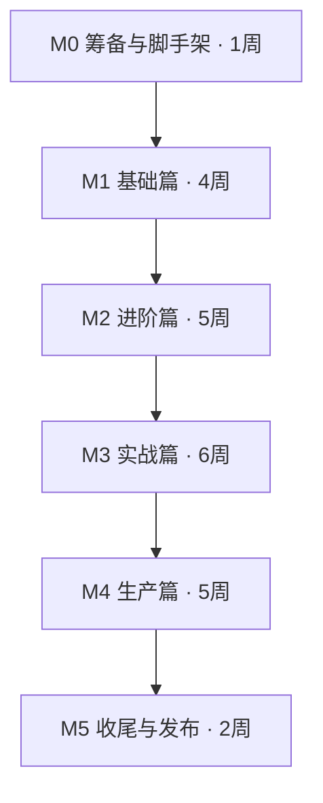

# Axum 工业级实战全书 · 写作 Roadmap

> 版本：v0.1（2026-10-23 制定）
> 状态：草案，随写作进度滚动更新
> 配套仓库：本仓库（书稿 `src/` + 示例代码 `examples/` + 完整项目 `realworld/`）

---

## 0. 项目定位

| 项目     | 内容                                                                                                       |
| -------- | ---------------------------------------------------------------------------------------------------------- |
| 书名     | 《Axum 工业级实战全书》                                                                                    |
| 定位     | 面向中级 Rust 开发者的生产级 Web 后端实战教程                                                              |
| 目标读者 | 掌握 Rust 基础（所有权、trait、异步入门）、写过 Web 服务、想用 Axum 做生产项目的人                         |
| 读完产出 | 能独立设计并交付一个**可观测、可测试、可部署**的 Axum 生产级服务                                           |
| 书稿语言 | 中文（代码注释与标识符用英文）                                                                             |
| 技术基线 | Rust 2024 edition · axum 0.8+ · tokio 1.x · hyper 1.x · tower 0.5+                                         |
| 主线项目 | 一个贯穿全书的 `realworld` 风格项目：**多租户任务/内容管理 API**（用户、团队、项目、任务、评论、实时通知） |

### 0.1 写作原则

1. **代码优先**：每章概念都落到可编译、可运行、有测试的代码上。
2. **工业级标准**：所有示例默认带日志、错误处理、配置、测试、Docker，不写"玩具代码"。
3. **单一主线项目**：全书围绕同一个 `realworld` 项目迭代演进，而非每章另起炉灶。
4. **版本一致**：全书所有示例由 CI 统一编译，锁同一套依赖版本。
5. **原理 + 实践**：涉及 tower/hyper/tokio 底层机制时，讲清"为什么"，再给"怎么做"。

---

## 1. 技术基线（写作启动日锁定）

| 类别        | 选型                                                  | 说明                                                                                                                                 |
| ----------- | ----------------------------------------------------- | ------------------------------------------------------------------------------------------------------------------------------------ |
| 框架        | **axum 0.8.x**                                        | 以写作启动日最新 patch 为准；0.8 关键变化：路径语法 `/{id}`（弃用 `/:id`）、`axum::serve` 取代 `Server`、公共 API 移除 `async_trait` |
| 运行时      | tokio 1.x（LTS）                                      | multi-thread runtime；后续章节深入 `spawn_blocking`、runtime 调优                                                                    |
| HTTP 层     | hyper 1.x                                             | axum 0.8 基于 hyper 1；讲连接管理、优雅停机时涉及                                                                                    |
| 服务抽象    | tower 0.5+                                            | 中间件/Service 模型；`ServiceBuilder` 组合                                                                                           |
| 中间件      | tower-http 0.6+                                       | CORS、Trace、Compression、RequestId、Timeout、ServeDir、CatchPanic 等                                                                |
| 序列化      | serde + serde_json                                    | 统一 JSON 响应规范                                                                                                                   |
| 错误处理    | thiserror + 自定义 `AppError`                         | 全书统一错误码体系（见 §5.3）                                                                                                        |
| 数据库      | **sqlx 0.8**（PostgreSQL 主线）                       | 离线宏 `query!`；迁移、事务、分页；sea-orm 作为附录对照                                                                              |
| 缓存/会话   | redis（fred 或 deadpool-redis 待定）                  | 分布式缓存、限流计数、会话                                                                                                           |
| 日志/可观测 | tracing + tracing-subscriber + OpenTelemetry          | 结构化日志、request-id 贯穿、metrics                                                                                                 |
| 配置        | figment 或 config（待定）                             | 分层配置 + 环境变量覆盖                                                                                                              |
| 测试        | tower::ServiceExt::oneshot + testcontainers           | 集成测试直接打 Router，不 mock HTTP 层                                                                                               |
| 工具链      | mdBook、just、cargo-deny、cargo-audit、cargo-llvm-cov | 见 §4                                                                                                                                |

> ⚠️ 第 0 阶段的第一件事：核对 axum/tower-http/sqlx 写作启动日最新版本并锁定到 `Cargo.toml`，全书统一。若届时 axum 0.9 已发布，评估后整体平移（风险见 §7）。

---

## 2. 总体里程碑



| 里程碑 | 内容               | 产出                                           | 预估 |
| ------ | ------------------ | ---------------------------------------------- | ---- |
| **M0** | 筹备与脚手架       | 仓库结构、CI、写作规范、版本锁定、`SUMMARY.md` | 1 周 |
| **M1** | 基础篇（Ch 1–5）   | 最小服务 → 完整 REST API                       | 4 周 |
| **M2** | 进阶篇（Ch 6–10）  | 中间件、状态、并发、数据库、认证               | 5 周 |
| **M3** | 实战篇（Ch 11–16） | `realworld` 项目全量落地 + 测试体系            | 6 周 |
| **M4** | 生产篇（Ch 17–20） | 可观测、安全、性能、部署                       | 5 周 |
| **M5** | 收尾               | 校对、交叉引用、习题答案、发布                 | 2 周 |

---

## 3. 全书目录（详细到节）

### 第一篇 · 基础篇：从零到完整 REST API（M1）

#### Ch 1 为什么是 Axum：Rust Web 生态地图

- **目标**：建立宏观认知，明确技术选型依据
- **小节**：
  - 1.1 Rust 服务端现状：Actix-web / Rocket / Poem / Salvo 对比
  - 1.2 Axum 的设计哲学：基于 tower + hyper 的薄封装、"正确性优先"
  - 1.3 全书项目预览：`realworld` 最终形态演示（API 列表、架构图）
  - 1.4 阅读约定：术语表、代码块约定、勘误方式
- **产出**：架构图（mermaid）、读者自检清单

#### Ch 2 快速上手：最小可用服务

- **目标**：15 分钟内跑起第一个服务，跑通开发闭环
- **小节**：
  - 2.1 环境准备（rustup、cargo-watch、just）
  - 2.2 Hello, Axum：`axum::serve` + `Router` + 路由处理器
  - 2.3 工程结构规范（bin/lib 分层、模块划分）
  - 2.4 开发工作流：热重载、`RUST_LOG`、快速迭代
- **配套代码**：`examples/ch02-hello-world`

#### Ch 3 路由系统

- **目标**：吃透 Router 的组织与匹配规则
- **小节**：
  - 3.1 Router 与 `merge` / `nest` / `fallback`
  - 3.2 路径语法：静态段、`/{id}` 参数、通配 `/{*rest}`（0.8 新语法及迁移）
  - 3.3 多方法处理与 `MethodRouter`（`get` / `post` / `any`）
  - 3.4 嵌套路由与作用域中间件（`nest` 的路径前缀）
  - 3.5 `routing::get` 与 handler 函数签名要求
  - 3.6 实践：规划 `realworld` 的完整路由表（RESTful 设计）
- **配套代码**：`examples/ch03-routing`

#### Ch 4 提取器（Extractor）

- **目标**：掌握 Axum 最核心的类型系统
- **小节**：
  - 4.1 提取器模型：`FromRequest` / `FromRequestParts` 与 handler 参数顺序
  - 4.2 内置提取器：`Path`、`Query`、`Json`、`State`、`HeaderMap`、`OriginalUri`
  - 4.3 `Option<T>` / `Result<T, E>` 与 `OptionalFromRequestParts`（0.8 变化）
  - 4.4 提取器组合：元组上限与自定义组合类型
  - 4.5 自定义提取器实战：`AuthUser`（从 header 解析 JWT）、`Tenant`（多租户上下文）
  - 4.6 请求体限制与 `Bytes` / multipart（预告 Ch 14）
- **配套代码**：`examples/ch04-extractors`

#### Ch 5 响应与错误处理

- **目标**：建立全书统一的响应与错误体系
- **小节**：
  - 5.1 `IntoResponse` 与响应构造（`Json`、`Html`、状态码、自定义 header）
  - 5.2 统一响应规范：`{code, message, data}` 信封 + 业务错误码表
  - 5.3 设计 `AppError`：thiserror + 错误分类（参数/业务/认证/上游/内部）
  - 5.4 `IntoResponse` for `AppError`：错误码 → HTTP 状态码映射表
  - 5.5 错误链与日志：`#[derive(thiserror::Error)]` + tracing 记录
  - 5.6 常见坑：handler 返回 `Result` 的 E 必须实现 `IntoResponse`
- **配套代码**：`examples/ch05-error-handling`（此后全书复用该错误体系）

---

### 第二篇 · 进阶篇：tower、并发、数据（M2）

#### Ch 6 中间件与 tower 服务模型

- **目标**：理解"为什么 Axum 的一切都是 tower Service"
- **小节**：
  - 6.1 tower `Service` / `Layer` 模型图解（poll-ready 模型简述）
  - 6.2 tower-http 全家桶：`TraceLayer`、`CorsLayer`、`CompressionLayer`、`RequestIdLayer`、`TimeoutLayer`、`CatchPanicLayer`
  - 6.3 `ServiceBuilder` 组合与**中间件顺序陷阱**（谁先执行、如何验证）
  - 6.4 自定义中间件：`from_fn` 与手写 `Layer`（限流中间件雏形）
  - 6.5 作用域：全局 / 路由级 / handler 级（`layer` vs `route_layer`）
  - 6.6 `middleware::from_fn_with_state` 与带状态中间件
- **配套代码**：`examples/ch06-middleware`

#### Ch 7 应用状态与配置管理

- **目标**：状态注入模式与 12-factor 配置
- **小节**：
  - 7.1 `State<T>` 注入：共享不可变状态（连接池、配置）
  - 7.2 状态内部可变性：`tokio::sync::RwLock` / `ArcSwap` 选型对比
  - 7.3 分层配置：figment/config + 环境变量覆盖 + 敏感信息处理
  - 7.4 多环境：dev / test / prod 配置切换
  - 7.5 可替换抽象：用 trait 解耦存储层（为 Ch 11 DDD 铺路）
  - 7.6 优雅启动流程：配置加载 → 连接池 → 中间件 → 监听
- **配套代码**：`examples/ch07-state-config`

#### Ch 8 异步运行时与并发模型

- **目标**：写出不阻塞、可压测的异步代码
- **小节**：
  - 8.1 tokio 运行时：worker 线程、任务调度速览
  - 8.2 阻塞陷阱：CPU 密集/同步 IO → `spawn_blocking` / `rayon`（配演示代码与对比基准）
  - 8.3 背压与超时：`TimeoutLayer`、`tower::limit`、信号量限流
  - 8.4 优雅停机：`with_graceful_shutdown` + `CancellationToken` 传导（连池排空、在途请求完成）
  - 8.5 连接池原理与调优（sqlx pool 参数：max/min/idle_timeout）
  - 8.6 常见坑：`Mutex` vs `RwLock` 跨 await、`select!` 取消安全
- **配套代码**：`examples/ch08-concurrency`（含压测脚本）

#### Ch 9 数据库实战（sqlx + PostgreSQL）

- **目标**：生产级数据访问全链路
- **小节**：
  - 9.1 选型论证：sqlx vs sea-orm vs diesel（迁移成本、编译期校验、运行时行为）
  - 9.2 连接池配置与 `PgPool` 注入
  - 9.3 Migrations：`sqlx migrate` + 版本化迁移文件规范
  - 9.4 离线宏 `query!`：编译期 SQL 校验、`#[derive(FromRow)]`
  - 9.5 事务与一致性：`PgTransaction`、嵌套事务、`FOR UPDATE` 乐观/悲观锁
  - 9.6 分页与过滤：keyset 分页 vs offset 分页、动态查询构造（QueryBuilder）
  - 9.7 慢查询排查：`EXPLAIN ANALYZE`、索引设计、N+1 识别
  - 9.8 测试策略：testcontainers 起真实 PG，不 mock 数据库
- **配套代码**：`realworld/infra` + `examples/ch09-db`

#### Ch 10 认证与会话基础

- **目标**：安全地实现第一版登录态
- **小节**：
  - 10.1 认证 vs 授权；Cookie 会话 vs JWT 对比（各场景取舍）
  - 10.2 密码存储：argon2（含参数调优）、防时序攻击
  - 10.3 JWT 实战：签发、校验、过期、`kid` 轮换（jsonwebtoken）
  - 10.4 提取器实战：`AuthUser` + 授权中间件（角色/权限）
  - 10.5 刷新令牌与登出；Redis 会话存储（Ch 15 深入）
  - 10.6 防暴力破解：登录限流（tower_governor 预告 Ch 18）
- **配套代码**：`examples/ch10-auth`（`realworld` 用户模块雏形）

---

### 第三篇 · 实战篇：realworld 项目全量落地（M3）

> 本篇开始，所有代码集中在 `realworld/` workspace，书稿按领域拆章。

#### Ch 11 领域建模与项目骨架

- **目标**：建立可长期演进的工程结构
- **小节**：
  - 11.1 workspace 分层：`api` / `application` / `domain` / `infra` / `shared`（轻量 DDD，不过度设计）
  - 11.2 领域模型：`Tenant` / `User` / `Project` / `Task` / `Comment` 实体与值对象
  - 11.3 用例（use case）层：应用服务与 Repository trait 边界
  - 11.4 依赖注入：手写组合根（不引 DI 框架）
  - 11.5 错误类型分层：`domain::Error` vs `api::AppError` 映射
  - 11.6 数据库 schema 设计：约束、索引、软删除、`updated_at` 触发器
- **配套代码**：`realworld/` 全部 crate 骨架 + migrations v1

#### Ch 12 用户系统与认证授权（升级版）

- **目标**：把 Ch 10 的雏形演进为完整用户体系
- **小节**：
  - 12.1 注册/登录/登出全流程（含邮箱验证、激活令牌）
  - 12.2 RBAC：角色、权限表设计 + 权限中间件
  - 12.3 多租户隔离：`Tenant` 上下文贯穿（提取器 + 查询过滤，防越权）
  - 12.4 账户安全：密码重置、失败锁定、审计日志
  - 12.5 单元 + 集成测试全绿（复用 Ch 16 测试基建）
- **配套代码**：`realworld/application/auth`

#### Ch 13 业务 CRUD 与查询工程

- **目标**：项目/任务核心业务的完整实现
- **小节**：
  - 13.1 Project / Task CRUD 全接口实现
  - 13.2 复杂查询：筛选、排序、搜索（`tsvector` 全文检索）
  - 13.3 分页封装：统一 `Page<T>` 响应结构
  - 13.4 评论与级联删除；软删除与回收
  - 13.5 权限校验矩阵：成员/访客/管理员对每个资源的操作
  - 13.6 批量操作与事务边界
- **配套代码**：`realworld/application/task` 等

#### Ch 14 文件上传与静态资源

- **目标**：处理文件的大流量路径
- **小节**：
  - 14.1 multipart 上传：`Multipart` 提取、大小限制、流式落盘（`tokio::fs`）
  - 14.2 对象存储抽象：本地磁盘实现 + S3 兼容实现（trait 切换）
  - 14.3 静态资源：`tower_http::services::ServeDir` + 缓存头 + SPA fallback
  - 14.4 文件下载：流式响应（`Body::from_stream`）、断点续传（Range）
  - 14.5 安全：类型校验（白名单）、病毒扫描（外部服务集成）、签名 URL
- **配套代码**：`realworld/application/file`

#### Ch 15 实时通信：WebSocket 与 SSE

- **目标**：任务通知/评论实时推送
- **小节**：
  - 15.1 `WebSocketUpgrade`：握手、消息收发、关闭语义
  - 15.2 广播模型：`tokio::sync::broadcast` 房间管理、心跳与掉线清理
  - 15.3 认证与 WS：握手阶段鉴权（query/header token）
  - 15.4 SSE 对比：事件流、自动重连、何时选 SSE 而非 WS
  - 15.5 背压与资源上限：连接数限制、写超时
- **配套代码**：`realworld/application/realtime`

#### Ch 16 测试体系

- **目标**：建立可复制到任何 Axum 项目的测试方法论
- **小节**：
  - 16.1 分层策略：单元（领域）/ 用例（fake repo）/ 集成（真实 PG）/ API（oneshot）
  - 16.2 `tower::ServiceExt::oneshot` 直测 Router：无需真实端口
  - 16.3 testcontainers：测试隔离、加速技巧（模板库、并行）
  - 16.4 测试替身：fake / mockall 选择；**优先 fake，少用 mock**
  - 16.5 快照测试（insta）与 golden 响应
  - 16.6 覆盖率：cargo-llvm-cov 基线（目标：领域层 ≥80%）
- **配套代码**：全书测试基建 `shared/testing`

---

### 第四篇 · 生产篇：可观测、安全、性能、部署（M4）

#### Ch 17 可观测性

- **目标**：服务上线后"看得见、查得到"
- **小节**：
  - 17.1 tracing 体系：spans 设计规范（request → usecase → sql）、字段约定
  - 17.2 结构化日志：tracing-subscriber JSON formatter、日志级别管理
  - 17.3 request-id 全链路贯穿：`RequestIdLayer` + 响应头 + 日志关联
  - 17.4 Metrics：`axum-prometheus` / 自定义指标（请求耗时、QPS、业务指标）
  - 17.5 OpenTelemetry：trace 导出到 Jaeger/Tempo（含 docker-compose 演示）
  - 17.6 健康检查：`/healthz`（liveness）/ `/readyz`（readiness，含 DB/Redis 探测）
- **配套代码**：`realworld/api/observability`

#### Ch 18 安全加固

- **目标**：对照 OWASP Top 10 逐项设防
- **小节**：
  - 18.1 输入校验：validator 库、路径/查询参数白名单
  - 18.2 请求体大小限制：`DefaultBodyLimit` + multipart 限制
  - 18.3 限流：tower_governor（IP + 用户维度）、熔断
  - 18.4 注入防护：SQL（sqlx 参数化天然免疫）、XSS（输出编码）、CSRF（API 场景分析）
  - 18.5 传输安全：TLS 终结（反向代理/rustls）、安全响应头（HSTS、CSP）、CORS 白名单
  - 18.6 依赖安全：cargo-audit、cargo-deny 进 CI
  - 18.7 安全审计日志与告警
- **配套代码**：`realworld/api/security`

#### Ch 19 性能优化与压测

- **目标**：用数据说话，形成调优方法论
- **小节**：
  - 19.1 压测工具与方法：oha / drill / k6 对比、压测环境隔离
  - 19.2 基线基准：hello-world、JSON 序列化、DB 查询三组基线
  - 19.3 常见瓶颈定位：profile（tokio-console、pprof）、慢查询、连接池耗尽
  - 19.4 优化清单：减少拷贝（`Bytes`）、连接复用、批量插入、缓存命中
  - 19.5 案例：`realworld` 从 2k → 20k QPS 的优化实录（逐步 diff 展示）
- **配套代码**：`benchmarks/` + 压测脚本

#### Ch 20 部署与运维

- **目标**：一键交付到生产
- **小节**：
  - 20.1 Docker 多阶段构建：musl/glibc、镜像瘦身（distroless）、`USER` 权限
  - 20.2 docker-compose 全栈编排：app + PG + Redis + 可观测组件
  - 20.3 Kubernetes：Deployment / Service / Ingress / 探针 / HPA 示例清单
  - 20.4 CI/CD：GitHub Actions（fmt → clippy → test → 镜像 → 部署）
  - 20.5 发布策略：滚动更新、优雅停机验证、数据库迁移与回滚策略
  - 20.6 运维手册：监控指标阈值、故障排查 SOP
- **配套代码**：`deploy/`（Dockerfile、compose、k8s、workflows）

---

### 附录（M5 一并完成）

- **附录 A** 依赖版本速查表（全书锁定版本 + 升级记录）
- **附录 B** `AppError` 错误码全表（业务码 ↔ HTTP 状态码 ↔ 消息）
- **附录 C** 术语表中英对照（handler/extractor/middleware/graceful shutdown…）
- **附录 D** sea-orm 对照实现（Ch 9 选型论证的补全）
- **附录 E** 每章习题参考答案
- **附录 F** 延伸阅读（官方文档、tower 教程、hyper 指南、相关书籍）

---

## 4. 示例代码工程规划

### 4.1 仓库结构

```
axum-book/
├── book.toml                    # mdBook 配置
├── Roadmap.md                   # 本文档
├── src/                         # 书稿（mdBook）
│   ├── SUMMARY.md
│   ├── part1/ch01-intro.md
│   └── ...
├── examples/                    # 每章独立小示例（可单独 cargo run）
│   ├── ch02-hello-world/
│   ├── ch03-routing/
│   ├── ch04-extractors/
│   ├── ch05-error-handling/
│   ├── ch06-middleware/
│   ├── ch07-state-config/
│   ├── ch08-concurrency/
│   ├── ch09-db/
│   └── ch10-auth/
├── realworld/                   # 贯穿全书的主线项目（workspace）
│   ├── Cargo.toml               # [workspace]
│   ├── migrations/              # sqlx 迁移文件
│   ├── crates/
│   │   ├── api/                 # axum 路由/提取器/中间件/启动
│   │   ├── application/         # 用例层（auth/task/file/realtime）
│   │   ├── domain/              # 实体、值对象、领域错误
│   │   ├── infra/               # PgPool、Redis、对象存储实现
│   │   └── shared/              # AppError、响应规范、config、testing 基建
│   └── tests/                   # API 集成测试（testcontainers）
├── benchmarks/                  # Ch 19 压测脚本与基准
├── deploy/                      # Dockerfile、compose、k8s、GitHub Actions
└── .github/workflows/ci.yml
```

### 4.2 CI 检查清单（M0 落地）

- [ ] `cargo fmt --check`
- [ ] `cargo clippy -- -D warnings`
- [ ] `cargo test`（含 doctest；testcontainers 用例在 CI 提供 docker 服务）
- [ ] `mdbook build` + `mdbook linkcheck`（校验书稿链接与代码路径引用）
- [ ] `cargo audit`（漏洞扫描）
- [ ] `cargo deny check`（许可证/重复依赖）
- [ ] 书中全部代码块路径与 `examples/`、`realworld/` 真实文件一一对应（写个校验脚本）
- [ ] 每章末尾的"代码速查"自动从源码生成（防止书稿与代码漂移）

---

## 5. 写作规范（M0 制定，全书遵守）

### 5.1 代码规范

- Rust 2024 edition；`cargo fmt` + `clippy -D warnings` 通过才允许入稿
- 标识符/注释用英文，书稿解释用中文
- 错误处理统一走 `AppError`（Ch 5 建立后，前 4 章示例允许简化但标注）
- 示例最小可运行：每个 `examples/ch*` 都带 `README.md`（运行方式 + 期望输出）

### 5.2 书稿规范

- 每章结构固定：目标 → 概念 → 代码 → 运行结果 → 常见坑 → 小结 → 习题
- 所有 API 示例统一使用 `curl` 演示；响应示例真实可复现
- 每章≤ 45 页；超量内容拆入附录
- 章与章之间用 `> 引用` 显式衔接；文末附"本章对应代码路径"

### 5.3 全书统一的 API 约定（`realworld`）

- 响应信封：`{"code": 0, "message": "ok", "data": ...}`
- 错误码分段：`1xxxx` 参数错误 / `2xxxx` 业务错误 / `3xxxx` 认证授权 / `5xxxx` 内部错误
- 认证：`Authorization: Bearer <JWT>`；租户：`X-Tenant-Id` 头
- 分页：`?page=1&page_size=20` → `data: {"items": [], "page": {...}}`

### 5.4 术语表（节选，附录 C 完整收录）

| 英文         | 中文   | 英文              | 中文     |
| ------------ | ------ | ----------------- | -------- |
| handler      | 处理器 | extractor         | 提取器   |
| middleware   | 中间件 | graceful shutdown | 优雅停机 |
| backpressure | 背压   | connection pool   | 连接池   |
| soft delete  | 软删除 | keyset pagination | 键集分页 |

---

## 6. 时间规划（按周拆解）

| 周次    | 里程碑 | 交付物                                     |
| ------- | ------ | ------------------------------------------ |
| W1      | M0     | 仓库/CI/规范/`SUMMARY.md` 全目录、版本锁定 |
| W2–W5   | M1     | Ch 1–5 书稿 + 示例代码 + 习题              |
| W6–W10  | M2     | Ch 6–10 书稿 + 示例 + `realworld` 骨架     |
| W11–W16 | M3     | Ch 11–16，`realworld` 功能全量 + 测试绿    |
| W17–W21 | M4     | Ch 17–20 + 部署全套 + 压测报告             |
| W22–W23 | M5     | 校对、链接校验、习题答案、术语表、发布     |

**双周检查点**：每两周出一版 PDF/HTML，找 1–2 名读者试读反馈（重点：示例能否一次跑通）。

---

## 7. 风险与备选方案

| 风险                              | 影响 | 应对                                                                                 |
| --------------------------------- | ---- | ------------------------------------------------------------------------------------ |
| axum 0.9 发布导致 API 变动        | 中   | M0 锁定版本；正文标注版本号；CI 编译所有示例可快速发现漂移；必要时单开"升级指南"附录 |
| sqlx 离线宏编译慢/环境要求高      | 中   | 主线 PG 离线模式；SQLite 备选分支；文档注明 `SQLX_OFFLINE`                           |
| 篇幅失控（预计 500+ 页）          | 高   | 每章 45 页上限；细节下沉附录；定期删减与主题无关内容                                 |
| 中文资料少，术语不统一            | 低   | 附录 C 术语表先行；写作中同步维护                                                    |
| testcontainers 在读者环境跑不起来 | 中   | 每个测试文件注释写明 Docker 前置条件；提供 SQLite 降级路径                           |
| 单人                              |
| 写作战线过长（23 周）             | 高   | M2 与 M4 可并行；基础篇稳定后即可连载发布积累反馈                                    |

---

## 8. 启动检查清单（Now → M0 完成）

- [ ] 更新 `book.toml`（`language = "zh-CN"`、启用搜索、配置输出）
- [ ] 按 §3 目录重写 `src/SUMMARY.md`
- [ ] 建立 `examples/`、`realworld/`、`benchmarks/`、`deploy/` 骨架
- [ ] 配置 GitHub Actions（§4.2）
- [ ] 核对并锁定依赖版本（§1）
- [ ] 撰写 Ch 1（含全书架构图）
- [ ] 完成 §5 写作规范终稿并固化到 `CONTRIBUTING.md`

---

> 本文档是活文档：每完成一个里程碑，勾选对应条目并记录偏差；章节规划可在写作中调整，但**技术基线、API 约定、目录骨架一旦冻结，不再随意变更**。
