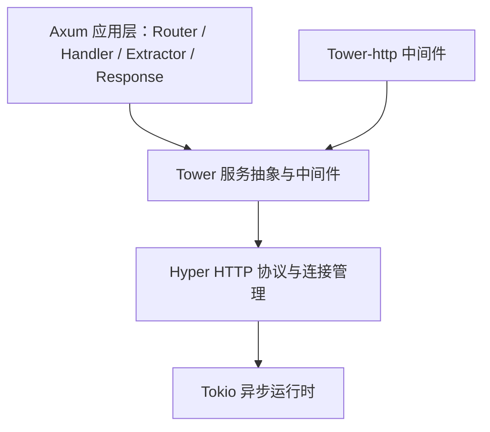

# Ch 1 为什么是 Axum：Rust Web 生态地图

> **本章目标**：建立对 Axum 的宏观认知——它是什么、为什么值得选、适合谁、不适合谁。

## 1.1 Rust 服务端现状：百花齐放，没有"唯一答案"

与 Python 的 Django / Flask、Node.js 的 Express、Java 的 Spring 不同，Rust 在 Web 服务端并没有一个占据绝对主导的"事实标准"。它呈现出多强并立的格局：`axum`、`actix-web`、`rocket`、`poem`、`salvo` 各有拥趸，且都称得上"生产可用"。

这种格局既是优点也是负担——优点是竞争推动了框架质量，缺点是新手容易陷入选型纠结。要做出理性判断，关键不是背参数，而是看清每个框架背后的两件事：

1. **抽象体系**：框架建立在什么抽象之上，决定你学到的东西能否跨框架复用；
2. **维护方与节奏**：谁在维护、迭代快慢，决定框架的长期生命力。

下表给出主流框架的一览对比，后文会围绕 Axum 逐条展开：

| 框架          | 底层/抽象                        | 路由风格          | 中间件体系         | 维护方                                     | 一句话点评                                          |
| ------------- | -------------------------------- | ----------------- | ------------------ | ------------------------------------------ | --------------------------------------------------- |
| **axum**      | tower + hyper + tokio            | 无宏，函数组合    | tower / tower-http | tokio 官方（tokio-rs）                     | 薄封装、正确性优先、抽象与生态通用                  |
| **actix-web** | actix-rt + actix-service（自研） | 属性宏 + resource | 自成体系           | 社区（Rob Ede 主导）                       | 老牌高性能，抽象自成一派，与 tower 生态不互通       |
| **rocket**    | 自研（构建于 tokio 之上）        | 属性宏驱动        | fairings           | Sergio Benitez                             | 类型安全先驱，API 优雅，但迭代慢（0.5 发布于 2022） |
| **poem**      | hyper + `Endpoint` 抽象          | 宏 + 组合子       | 兼容 tower         | 社区（poem-web）                           | 内置 OpenAPI，与 axum 理念接近，集成度更高          |
| **warp**      | hyper + `Filter`                 | `Filter` 组合子   | `Filter` 体系      | 社区（hyper 作者 Sean McArthur，维护趋缓） | axum 之前 tokio 生态的宠儿，如今已被 axum 取代      |

**选型建议**：新项目默认考虑 Axum；已经深度使用 actix-web 或对某些框架的独有特性（如 rocket 的声明式路由、poem/salvo 的内置 OpenAPI）有刚需，再作他选。本书聚焦 Axum，正是因为它在"正确性、生态通用性、可维护性"三者上取得了最好的平衡。

## 1.2 Axum 是什么：薄封装与"正确性优先"

Axum 是由 tokio 团队（tokio-rs 组织）维护的 Rust Web 框架。更准确地说，它是一个**HTTP 路由与请求处理库**，构建在 `hyper` + `tower` + `tokio` 之上。

Axum 的核心定位是**薄封装**：它自己不去实现 HTTP 协议、不去实现异步运行时、也不发明一套中间件体系，而是把这三件事分别交给 `hyper`、`tokio` 和 `tower`，自己只专注做好一件事——**类型安全的路由、提取器、响应与错误模型**。这种"站在巨人肩膀上、只做自己那一层"的选择，是理解 Axum 一切设计取舍的钥匙。

### 1.2.1 架构分层：站在巨人肩上

下面的分层图展示了请求从应用到协议再到运行时的完整链路：



| Layer | 职责                              | Axum 做了什么                                |
| ----- | --------------------------------- | -------------------------------------------- |
| Tokio | 异步运行时、任务调度              | 无（直接复用）                               |
| Hyper | HTTP 协议、连接管理、优雅停机     | 无（自 0.7 起基于 hyper 1.x）                |
| Tower | `Service` 抽象、中间件、超时/限流 | 无（`Router` 本身就是一个 `tower::Service`） |
| Axum  | 路由、提取器、响应、错误模型      | **只做这一层，做得极精**                     |

用一句话概括这套分工：

> **Axum = Hyper（HTTP 协议）+ Tower（服务抽象）+ 类型安全的路由 / 提取器 / 响应体系。**

这套分工带来的最大红利是**抽象通用**：你在 axum 里学到、写下的 `tower::Service` 心智模型与中间件代码，不是"框架私有财产"，而是可以原封不动地用到 `tonic`（gRPC）、甚至直接下沉到裸 `hyper` 上。

### 1.2.2 核心能力：四个"极简但足够"

Axum 的全部 API 面，可以概括为四个关键词：

1. **无宏路由**（macro-free API）：路由用普通函数组合，不需要 `#[get("/")]` 这类属性宏，编译器与 IDE 能完整感知、跳转、重构；
2. **提取器**（extractor）：以声明式方式从请求中解析 `Path` / `Query` / `Json` / `State` / `Header`，类型不匹配会在**编译期**报错，而非上线后 500；
3. **简单可预测的错误模型**：handler 返回 `Result<T, E>`，只要满足 `T: IntoResponse` 且 `E: IntoResponse`，成功与失败就能统一转成 HTTP 响应；
4. **极简的响应构造**：只需要`(StatusCode::CREATED, Json(user))` 这种元组即可表达"状态码 + 响应体"，样板代码被压到最少。

下面这段代码把四个能力串在了一起：

```rust
// 路由声明：普通函数组合，无属性宏
let app = Router::new()
    .route("/tasks/{task_id}", get(get_task))
    .with_state(pool);

// 处理器：提取器按需声明，响应须符合 Result + IntoResponse
async fn get_task(
    Path(task_id): Path<Uuid>,        // 路径参数类型化，解析失败自动 400
    Query(page): Query<PageParams>,   // 查询参数反序列化
    State(pool): State<PgPool>,       // 共享状态注入
) -> Result<Json<Task>, AppError> {   // 错误类型实现 IntoResponse，自动转响应
    // ...
}
```

路由拼错、提取器类型不匹配、状态漏注入——这些问题都会被 Rust 的类型系统在编译期拦下。这种体验不是 axum"发明"的，而是它把 Rust 类型系统用到了极致的结果。

## 1.3 为什么推荐 Axum

### 1. 生态正统，学一次吃透整个 Rust 服务端栈

axum 由 tokio 团队维护，和 `hyper`、`tonic`（gRPC）、`tower` 共享同一套抽象。这意味着：

- 你为 axum 写的中间件 / 限流 / 超时逻辑，可以直接用到 tonic gRPC 服务上；
- 你在 axum 里积累的 `tower::Service` 心智模型，向下兼容 hyper 裸写，向上覆盖全生态；
- 不存在"框架私有抽象锁死"的问题——这是它和 actix-web 最本质的区别。

### 2. 正确性优先，工程质量是它的卖点

从源码仓库可以直接验证这套工程标准：

- 工作区 lint 强制 **`unsafe_code = "forbid"`**（全 crate 无 `unsafe`）；
- 明确的 MSRV 策略（在 `Cargo.toml` 中通过 `rust-version` 字段声明）；
- 严格遵循 semver，0.x 期间的 breaking change 都有完整 changelog 与迁移说明；
- 官方 README 会主动提示"main 分支含破坏性变更，生产请看稳定分支"。

对生产项目而言，"框架少坑"往往比"框架多快"更值钱。

### 3. 性能第一梯队，且足够

在 TechEmpower Web Framework Benchmarks 的纯框架测试中，axum 与 actix-web 常年位居第一梯队，二者吞吐差距通常只有几个百分点。而对绝大多数业务（毫秒级数据库操作主导延迟）来说，框架吞吐早已不是瓶颈。
选型的正确姿势是在性能接近时，比较正确性、生态与可维护性——这正是 axum 的强项。

### 4. 类型安全 + 无宏，开发体验与可维护性兼得

如 1.2.2 所示，类型安全与无宏带来的不只是"少写几行样板"，而是：

- 重构更安全：改了状态类型或路由签名，编译器会替你找到所有失效的调用点；
- IDE 支持更好：没有宏魔法，跳转、补全、重命名都开箱即用；
- 新人上手更快：所见即所得的普通函数，比"注解 + 隐式注入"的心智负担更低。

## 1.4 什么时候不推荐 Axum

Axum 不是银弹。以下场景需要三思：

1. **你需要"全家桶"开箱即用**（内置 ORM、模板引擎、表单校验）：axum 刻意不做这些，需要自行组合 `sqlx`、`askama`、`validator` 等，这既是自由也是成本；
2. **你需要深度定制 HTTP 协议行为**（如自定义连接调度、底层流控）：薄封装意味着有些时候需要下沉到 `hyper` 或 `tower` 处理；
3. **你无法接受 0.x 阶段的 breaking change**：axum 尚未发布 1.0 稳定版，次要版本之间仍有破坏性变更（例如 0.7 → 0.8 修改了路径参数语法与启动 API）。本书锁定 0.8.x，团队若要升级，需跟进 changelog 与官方迁移指南。
