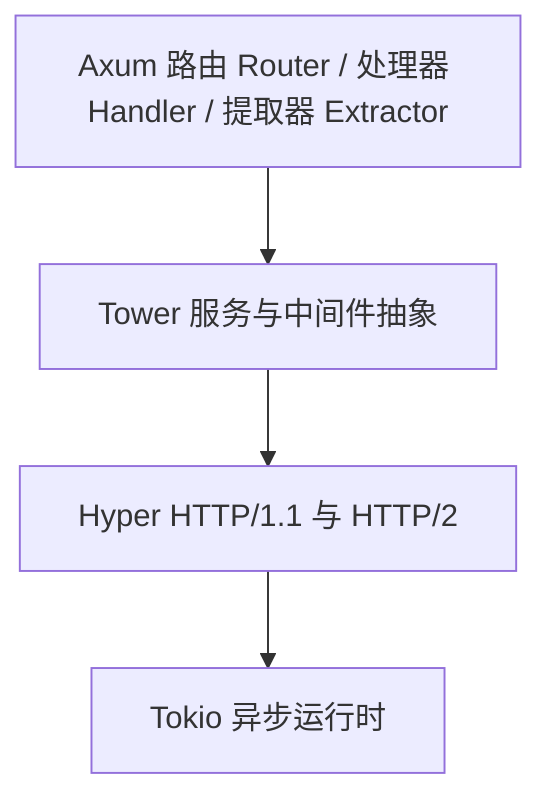

# Axum 介绍

## Axum 是什么

**Axum** 是一个现代，高性能且类型安全的 Rust Web 框架，由 Rust 异步生态的事实标准制定者 -- **Tokio** 团队亲儿子级别独立打造。

与其他语言高度依赖 "运行时反射(Reflection)" 和过度依赖 "宏(Macros)" 的 Web 框架不同，
Axum 的核心哲学是彻底榨干 Rust 的类型系统。它在编译期完成路由匹配，请求解析和响应生成的安全检查。

Axum 不是空中楼阁，它从诞生之初就是为了无缝整合 Rust 底层最成熟的生态:

- Hyper: 接入底层工业级的 HTTP 引擎，提供极致的解析性能。
- Tower: 接入生态标准的 Service/Layer 抽象，用于构建组件和中间件。
- Tokio: 接入坚如磐石的异步运行时，驱动高并发的网络事件循环。

## 为什么推荐 Axum

## 本章目标

建立宏观认知，明确技术选型依据。

## 小节规划

- 1.1 Rust 服务端现状：Actix-web / Rocket / Poem / Salvo 对比
- 1.2 Axum 的设计哲学：基于 tower + hyper 的薄封装、"正确性优先"
- 1.3 全书项目预览：`realworld` 最终形态演示（API 列表、架构图）
- 1.4 阅读约定：术语表、代码块约定、勘误方式

## 配套代码

- 本章无示例代码；产出全书架构图（mermaid）与读者自检清单

## 写作清单

- [ ] 撰写正文
- [ ] 绘制全书架构图
- [ ] 完成读者自检清单
- [ ] 添加章末习题
