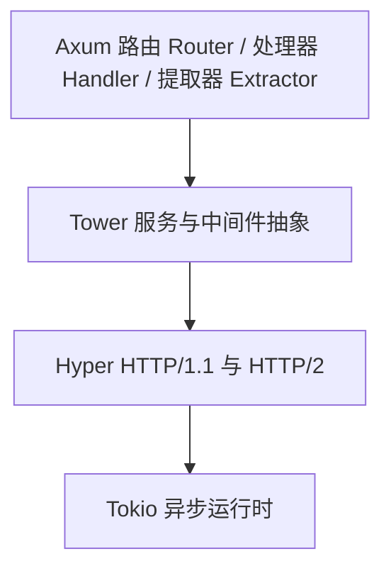

# Axum 介绍

## Axum 是什么

**Axum** 是一个现代，高性能且类型安全的 Rust Web 框架，由 Rust 异步生态的事实标准制定者 -- **Tokio** 团队亲儿子级别独立打造。

与其他语言高度依赖 "运行时反射(Reflection)" 和过度依赖 "宏(Macros)" 的 Web 框架不同，
Axum 的核心哲学是彻底榨干 Rust 的类型系统。它在编译期完成路由匹配，请求解析和响应生成的安全检查。

Axum 不是空中楼阁，它从诞生之初就是为了无缝整合 Rust 底层最成熟的生态:

- Hyper: 接入底层工业级的 HTTP 引擎，提供极致的解析性能。
- Tower: 接入生态标准的 Service/Layer 抽象，用于构建组件和中间件。
- Tokio: 接入坚如磐石的异步运行时，驱动高并发的网络事件循环。

## 为什么推荐 Axum

在当下的 Rust 服务器端领域，Axum 已经成为新项目技术选型的热门默认选项之一。
对于熟悉 TypeScript 和 Java 等其它语言的资深 Web 开发者来说，Axum 展现出了惊人的现代软件工程美学。

1. **编译期类型安全**

   在 Java Spring 等传统框架中，如果接口参数定义错误，或者漏掉了某个注解，往往要等到程序运行起来，甚至在生产环境收到请求时才会抛出错误。

   Axum 的优势：它通过 `FromRequest` 和 `FromRequestParts` 等 trait, 在编译期对提取器的组合方式做类型检查。
   例如，请求体提取器(如 `Json<T>`) 必须放在参数列表最后，且一个 Handler 中只能有一个。如果 Handler的参数类型与路由设计不匹配，代码会直接无法通过编译。

   需要澄清的是，Axum 并不能在编译器校验"传入的 HTTP Request"本身。请求体是否为合法的 JSON, 路径参数能否解析为目标类型，仍然是在运行时由提取器判断的。编译期能拦住的是提取期组合和类型层面的错误，而非请求数据的合法性。

2. **一切皆服务的 Tower 生态**

   Axum 没有自造一套封闭的中间件生态，而是完全拥抱了 Tower 协议标准

   - 流水线组合：在 Tower 体系中，无论是限流(Rate Limiting), 跨域(CORS), 鉴权(Auth) 还是日志追踪(Tracing), 都只是一个标准的 Layer。多个 Layer 会像洋葱一样逐层包裹路由: 请求从最外层依次进入，达到 Handler 后再逐层返回，每一层都能再请求进入和响应返回时分别执行对用的逻辑。

   - 零开销抽象：依托 Rust 的编译器优化，多层中间件在编译后会被单态化并内联，运行时开销很低。

## 本章目标

建立宏观认知，明确技术选型依据。

## 小节规划

- 1.1 Rust 服务端现状：Actix-web / Rocket / Poem / Salvo 对比
- 1.2 Axum 的设计哲学：基于 tower + hyper 的薄封装、"正确性优先"
- 1.3 全书项目预览：`realworld` 最终形态演示（API 列表、架构图）
- 1.4 阅读约定：术语表、代码块约定、勘误方式

## 配套代码

- 本章无示例代码；产出全书架构图（mermaid）与读者自检清单

## 写作清单

- [ ] 撰写正文
- [ ] 绘制全书架构图
- [ ] 完成读者自检清单
- [ ] 添加章末习题
