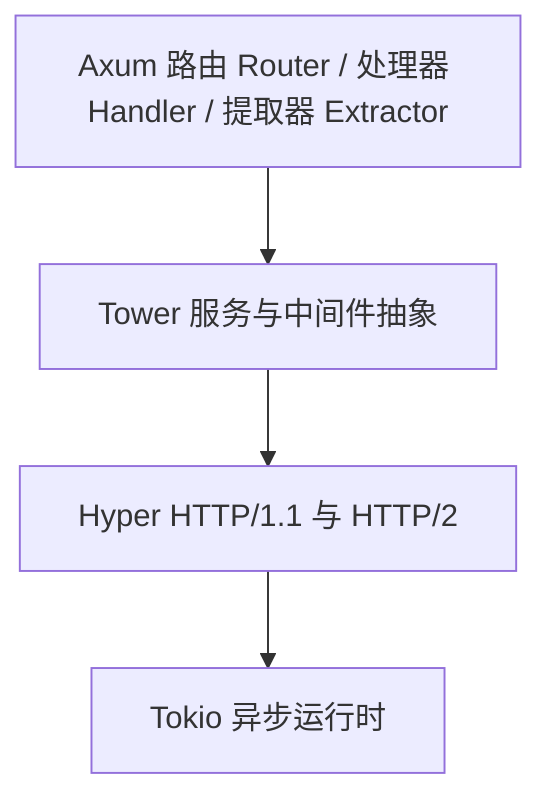

# Axum 介绍

## Axum 是什么

**Axum 是由 tokio 官方团队维护的 Rust Web 框架——更准确地说，它是一个先进高效的 HTTP 路由与请求处理库**，构建在 `hyper` + `tower` + `tokio` 之上，是当前 Rust Web 服务端开发的事实主流之选。Axum 是 "薄封装"：自己不实现 HTTP 协议、不实现异步运行时、不发明中间件体系，全部站在巨人肩膀上：



| Layer | 职责                              | axum 做了什么                                |
| ----- | --------------------------------- | -------------------------------------------- |
| tokio | 异步运行时                        | 无（直接复用）                               |
| hyper | HTTP 协议、连接管理               | 无（0.8 起基于 hyper 1.x）                   |
| tower | `Service` 抽象、中间件、超时/限流 | 无（`Router` 本身就是一个 `tower::Service`） |
| axum  | 路由、提取器、响应、错误模型      | **只做这一层，做得极精**                     |

所以准确的说法是：**Axum = Hyper（HTTP）+ Tower（服务抽象）+ 类型安全的路由/提取器/响应体系**。

### Axum 核心能力

1. **无宏路由**（macro-free API）：路由用普通函数组合，不需要 `#[get("/")]` 这类属性宏；
2. **提取器**（extractor）：声明式地从请求中解析 `Path` / `Query` / `Json` / `State` / `Header`，类型不对**编译期报错**；
3. **简单可预测的错误模型**：handler 返回 `Result<T, E>`，只要 `E: IntoResponse` 就能统一转成 HTTP 响应；
4. **极简的响应构造**：`(StatusCode::CREATED, Json(user))` 这种元组即可，样板代码最少；

## 为什么推荐 Axum

1. 生态正统，学一次吃透整个 Rust 服务端栈

   axum 由 tokio 团队维护，和 `hyper`、`tonic`（gRPC）、`tower` 共享同一套抽象。这意味着：
   - 你为 axum 写的中间件/限流/超时逻辑，可以直接用到 tonic gRPC 服务上；
   - 你在 axum 里积累的 `tower::Service` 心智模型，向下兼容 hyper 裸写，向上覆盖全生态；
   - 不存在"框架私有抽象锁死"的问题——这是它和 actix-web 最本质的区别。

2. 正确性优先，工程质量是它的卖点

   从源码仓库可以直接验证：

   - 工作区 lint 强制 **`unsafe_code = "forbid"`**（全 crate 无 unsafe）；
   - 明确的 MSRV 策略（`rust-version` 字段声明）；
   - 严格 semver，0.x 期间的 breaking change 都有完整 changelog 和迁移说明；
   - 官方 README 甚至会主动提示"main 分支含破坏性变更，生产请看 0.8.x 分支"。

   对于生产项目，"框架少坑"比"框架多快"值钱得多。

3. 性能第一梯队，且足够

   axum 与 actix-web 长期处于 TechEmpower 纯框架基准的第一梯队，二者差距通常只有几个百分点。对绝大多数业务（毫秒级 DB 操作主导延迟）而言，框架吞吐早已不是瓶颈。**选型的正确姿势是在性能接近时，比正确性、生态和可维护性——这正是 axum 的强项。**

4. 类型安全 + 无宏，开发体验与可维护性兼得

   ```rs
   async fn get_task(
       Path(task_id): Path<Uuid>,        // 路径参数类型化，解析失败自动 400
       Query(page): Query<PageParams>,   // 查询参数反序列化
       State(pool): State<PgPool>,       // 共享状态注入
   ) -> Result<Json<Task>, AppError>     // 错误自动转响应

   ```

   路由拼错、提取器类型不匹配、状态漏注入——全部编译期暴露，而不是上线后 500。这种体验来自 Rust 的类型系统，axum 把它用到了极致。

## 什么情况下不推荐 Axum

1. 你需要"全家桶"开箱即用（内置 ORM、模板、表单校验）——axum 刻意不做，需自行组合（sqlx、askama、validator）；
2. 你深度定制 HTTP 协议行为（如自定义连接调度）——薄封装意味着有时需要下沉到 hyper；
3. 0.x 阶段仍有 breaking change（0.9 已在路上），团队需跟进 changelog。

## 常见 Rust 服务端框架对比

| 框架          | 底层/抽象                        | 路由风格       | 中间件体系         | 维护方               | 一句话点评                                |
| ------------- | -------------------------------- | -------------- | ------------------ | -------------------- | ----------------------------------------- |
| **axum**      | tower + hyper                    | 无宏，函数组合 | tower / tower-http | tokio 官方           | 薄封装、正确性优先、生态正统              |
| **actix-web** | actix-rt + actix-service（自研） | 宏 + resource  | 自成体系           | 社区（Rob Ede 主导） | 老牌高性能，抽象自成一派，与 tower 不互通 |
| **rocket**    | 自研（基于 tokio）               | 属性宏驱动     | fairings           | Sergio Benitez       | 类型安全先驱，迭代慢（0.5 发布于 2022）   |
| **poem**      | hyper + Endpoint                 | 宏 + 组合子    | 可接 tower         | Sunli                | 内置 OpenAPI，与 axum 理念接近            |
| **warp**      | hyper + Filter                   | 组合子         | Filter 体系        | 社区（维护趋缓）     | axum 之前 tokio 生态的宠儿，已边缘化      |
