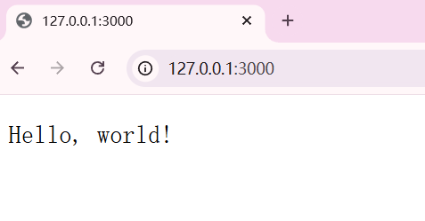

# Ch 2 快速上手：最小可用服务

> **本章目标**：跑起第一个 Axum 服务，并搭建好热更新的开发模式

## 2.1 环境准备

### 2.1.1 安装 Rust 工具链

Rust 工具链由 `rustup` 统一管理，包含编译器 `rustc` 和包管理器 `cargo`。 先确认它们可用:

```sh
rustc --version
cargo --version
```

如果在 terminal 中看到类似下面的输出，说明环境已就绪：

```text
rustc 1.85.0 (...)
cargo 1.85.0 (...)
```

本书统一使用 **Rust 2024 edition**, 要求 rustc 1.85 或更高的版本。如果版本过旧，请先升级：

```sh
rustup update
```

如果还没有安装 Rust, 请到 [Installing Rust](https://rust-lang.org/learn/get-started/) 按官网说明安装对应平台的 Rust。

### 2.1.2 开发工具

推荐两款 Rust 开发工具，

- [Zed](https://zed.dev/): • 下一代专为高性能与 AI 协同而生的轻量级代码编辑器。由 Rust 语言构建，支持 GPU 硬件加速，拥有极致的启动速度与打字响应率。同时，它原生集成了多款尖端 AI 结对编程助手。本书采用 `Zed` 作为核心开发工具。
- [Vs code](https://code.visualstudio.com/): • 目前全球最成熟、最流行的通用代码编辑器。搭配官方首选的 `rust-analyzer` 插件，即可获得无与伦比的强类型补全、代码重构及宏展开跳转体验，是目前绝大多数 Rust 工程师的生产力标配。

## 2.2 Hello world

在写代码之前，我们先建立心智模型。一个最小的 Axum 服务，它本质上是三块拼图。


- **Router 路由表**：告诉程序哪个路径，哪种 HTTP 方法，需要交给哪个函数处理。比如将 `/` 的路径的 GET 请求交给 `root` 函数。
- **Handler 处理器**：一个普通的异步函数，负责处理请求并返回响应。

### 2.2.1 第一个最小服务

明白了上述 Axum 服务拼图， 我们把相关代码写到一个 cargo 项目的 `main.rs` 文件里。

先创建项目

```sh
cargo new hello-world
```

然后添加 `axum` 和 `tokio` 依赖，这里我们使用 axum 0.8 并且启用 tokio 所有的功能。

```sh
cargo add axum@0.8
cargo add tokio@1 -F full
```

打开 `hello-world` 项目我们可以看到项目中有`Cargo.toml` 和 `src/main.rs` 两个文件。

打开 `Cargo.toml` 文件我们可以看到下面的内容

```toml
[package]
name = "hello-world"
version = "0.1.0"
edition = "2024"

[dependencies]
axum = "0.8"
tokio = { version = "1", features = ["full"] }
```

`Cargo.toml` 文件定义的当前项目的元信息以及所需要的第三放依赖信息。然后我们打卡 `src/main.rs` 文件并将下面的内容复制到`main.rs` 文件钟。

```rs
use axum::{Router, routing::get};

#[tokio::main]
async fn main() {
    let app = Router::new().route("/", get(root));

    let listener = tokio::net::TcpListener::bind("127.0.0.1:3000")
        .await
        .unwrap();
    axum::serve(listener, app).await.unwrap();
}

async fn root() -> &'static str {
    "Hello, world!"
}

```

### 2.2.2 运行服务

在 terminal 中使用 `cargo run` 运行服务。当在 terminal 中看到下面的结果时表示服务启动成功，并且服务正在监听 `127.0.0.1:3000`

```text
Finished `dev` profile [unoptimized + debuginfo] target(s) in 2.12s
Running `target\debug\hello-world.exe`
```

打开一个浏览器，并在地址栏输入 `http://127.0.0.1:3000`, 然后回车，我们即可看到下面的内容:


这样我们的第一个 Axum 服务器就完成了，是不是十分的简单。

### 2.2.3 拆解 main.rs

我们先分析 `main` 函数

- `#[tokio::main]属性宏`: 我们知道 Rust 的 main 函数默认不能是异步的。因此使用了来自 tokio 的属性宏 `#[tokio::main]` 包裹 main 函数，使其能够支持异步运行时。这样我们可以在 main 函数中使用异步操作。同时各类网络服务操作基本都是异步的，依次该属性宏是必不可少的。
- `Router::new().route("/", get(root))`:
  - `Router::new()` 方法会生成一个 Router, 然后通过 `route` 方法注册了一个路由规则 —— url 路径为 `/` 的 GET 请求交给 `root` 函数处理。
  - `get(root)`：来自 `routing` 的 `get` 方法是一个由 HTTP 方法过滤器。它唯一的职责是：明确声明该路由只接收 HTTP GET 请求，并将一个普通的异步函数 (Handler) 包装成 axum 支持的网络服务。
- `tokio::net::TcpListener::bind("127.0.0.1:3000")`: 创建一个 `TcpListener`, 监听 `127.0.0.1` 本机 ip, 并绑定本机 3000 端口。因为该操作是异步的，因此使用 `.await` 等待该操作完成，同时使用 `unwrap()` 直接开箱获取成功创建的 `listener`, 如果不成功则直接 panic。
- `axum::serve(listener, app).await.unwrap()`: 将创建的 listener 和 app(路由) 交给 axum, 开始循环接受并处理请求。这个 `await` 在正常运行时永远不会返回，所以程序会一直卡在 `Running target\debug\hello-world.exe` 这里 —— 这正是服务器应有的样子。

再分析 handler:

- `async fn root() -> &'static str`: handler 就是一个普通的异步函数，没有任何魔法。返回值 `&'static str` 会被自动的转化成 HTTP 响应(内容是： `Hello, world`, 状态码是 `200 ok`)
- 得益于 Rust 的类型系统，任何返回值只要它的类型实现了 `IntoResponse` trait, 即可用作 handler 的返回类型。Axum 为 `&'static str`, `String`, `Json` 等类型实现了 `IntoResponse` trait，因此它们可以做为 Handler 的返回类型。

## 2.3 工程优化

我们来做一个非常重要的结构调整。

### 2.4 可选但推荐的工具

#### bacon

`bacon` 用于监听源码变化，一旦有改动就自动重新编译，重启服务，实现 "改完即生效" 的热重载。

1. 使用 `--locked` 确保依赖树完全锁定，安装最稳定的生产级版本。

   ```sh
     cargo install --local bacon
   ```

2. 安装完成后，我们需要到项目根目录钟初始化 bacon 配置

   ```sh
     bacon --init
   ```

   这会在项目根目录下自动生成一个 `bacon.toml` 配置文件。bacon 的配置文件钟内置了 `check`,`clippy`, `test` 等默认任务(jobs), 我们也可以添加自定义的任务如 `jobs.run`

   ```toml
   # 1. 定义专属的开发热重载运行任务
   [jobs.run]
   command = ["cargo", "run"]
   need_stdout = true
   allow_warnings = true

   # 2. 核心优化：配置文件监控的过滤规则
   [bacon]
   ignore = []
   ```

   然后通过 `bacon run`, 即可在后台拉起 Axum 服务。一旦按下 `Ctrl + S` 保存新修改的内容 bacon 会自动重新执行相关的任务：重新编译，原地重启 Axum 进程等。
