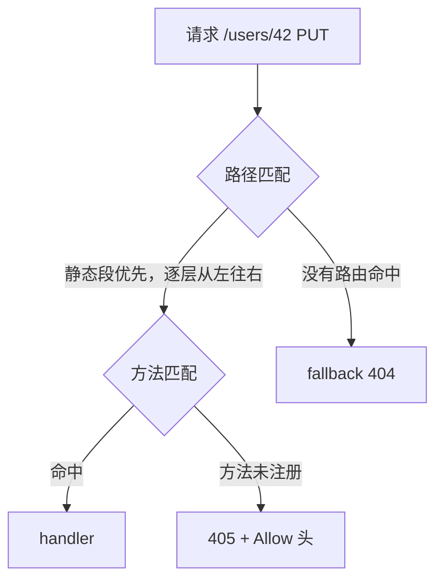

# Ch 3 路由系统

> 本章目标：吃透 Router 的组织与匹配规则。读完这一章，任意一个请求打进你的服务，你在心里就能算出它落在哪个 handler。
>
> 上一章我们跑起了最小服务，所有请求都交给 `/` 一条路由。真实的 API 有几十条路由、几种 HTTP 方法、还要按业务分组。这一章把路由这件事拆到底。

## 3.1 Router

### 3.1.1 心智模型：路由表是一台电话总结

我们可以把 `Router` 想象成一台电话总机，请求就是打进来的电话。

- **路由表**相当于总机桌上的号码簿：一条 `route` 就是一行 “哪个号码转给哪个分机”。
- **静态段**（`/users/me`）是直拨分机号，一个号码对应一个分机。
- **捕获段**（`/users/{id}`）是号码段规则，“8 开头全部转销售部”。匹配范围比直拨大，优先级比直拨低。
- **通配段** （`/assets/{*path}`）是线内转接：剩下的号码不管多长，原样转过去。
- **405** 是“分机存在，但占线”：路径找到了，但方法对不上。
- **fallback** 是空号提示音：整张号码簿都翻不到，才轮到它。有且只有一条。

总机接电话的裁决顺序是固定的



记住这条链：**先按路径找位置，再按方法定去留，最后 fallback 兜底。** 本章要讲的三处"反直觉行为"，全是这条链的推论。

### 3.1.2 组装路由：route

`route` 是 Axum 中路由表最基本的添加路由的入口，它接收两个参数：

- 第一个参数 `path` 是路由的路径
- 第二个参数是 `MethodRouter`, 一个或几个 HTTP 方法对应的 handler 集合

本章的示例服务把全部知识点装进一个路由表，完整代码在 `examples/ch03-routing`。先看总装图：

```rust
{{#include ../../examples/ch03-routing/src/lib.rs:app}}
```

```text
examples/ch03-routing
├── Cargo.toml
└── src/
    ├── main.rs   # 启动壳：日志 + 监听 + axum::serve
    └── lib.rs    # 路由表 app() + 19 个测试
```

`app()` 就是整个服务。我们先把它运行起来

```sh
cd examples/ch03-routing/
cargo run
```

服务监听 `http://127.0.0.1:3000`
然后用 curl 模拟请求：

```sh
curl http://127.0.0.1:3000
# hello from ch03
```

### 3.1.3 合并路由：merge

几十个路由塞在一个函数里，代码的可读性很快就就会归零。通过 `merge` 方法可以解决整个问题：先把不同业务的路由各自组装好，然后再组装成一个总路由。如下面的代码中我们用 `merge` 将`user_routes` 和 `asset_routes`两个路由合并成一个总路由。

```rust
let user_routes = Router::new()
    .route("/users", get(list_users).post(create_user))
    .route("/users/{id}", get(get_user));

let asset_routes = Router::new()
    .route("/assets/{*path}", get(get_asset));

let app = Router::new()
    .merge(user_routes)
    .merge(asset_routes);
```

`merge` 方法是将不同的路由合并在一起，路由之间是并联的关系，要使路由具有层级关系应该使用 `nest`。注意完全相同的路由 merge 会触发重叠 panic。`merge` 方法有两个限制：

1. 两个 Router的 state的类型必须一致。带不同 state 的 Router 不能直接合并，需要先使用 `with_state` 方法对齐 Router 的 state.
2. 两个 Router 不能同时有 fallback, 类似空号提示音全局只有一条。否则会直接 panic。

### 3.1.4 嵌套路由：nest

`merge` 是将路由合并在一起，`nest` 则是使路由具有层级关系。它通过把整个子路由挂到某个路径前缀下面实现路由嵌套，如下面的路由代码中，把 `api_v1` 路由通过 nest 方法挂在了 `/api/v1` 路径下。

```rust
let api_v1 = Router::new()
    .route("/ping", any(ping))
    .route("/health", get(health));

let app = Router::new().nest("/api/v1", api_v1)；
```

这时 `GET /api/v1/health` 由 `health` 处理。这样 API 版本化。如我们要实现`v2` 版本的 api，只需要加一个 `nest("/api/v2", api_v2)`就可以了。

`nest` 有两个硬规则：

- **路径不能含通配段**，如`nest("/api/{*rest}", ...)` 将直接 panic：

  ```text
  Invalid route: nested routes cannot contain wildcards (*)
  ```

- **路径不能是根路径**，如`nest("/", ...)`， 在 axum 0.8 中这会 panic：

  ```text
  Nesting at the root is no longer supported. Use merge instead.
  ```

  对于根路径，应该使用用 `merge` 方法，将子路由合并到总路由中。

### 3.1.5 fallback

`fallback` 注册全局唯一的那条兜底的"空号提示音"。它只处理一种请求：**路径不匹配任何路由**的请求。

```rust
{{#include ../../examples/ch03-routing/src/lib.rs:middleware_and_fallbacks}}
```

```sh
$ curl http://127.0.0.1:3000/nope
no route for /nope
```

注意 `handle_404` 收到了 `Uri` 提取器 —— 跟普通的 handler 一样，fallback handler可以用任何提取器拿到请求信息。

一个容易误会的点：**方法不匹配不会触发 fallback**。如`GET /users` 存在而 `DELETE /users` 未注册时，返回的是 405，不是 fallback。就像电话总机的"分机号存在但占线"和"空号"是两回事。

### 3.1.6 开发期 panic

Axum router 的校验哲学是"配置错误当场爆炸"，不让错误拖到运行时变成 404。以下是router注册期最常见的三个 panic：

| 操作                              | panic 信息                                                       |
| --------------------------------- | ---------------------------------------------------------------- |
| merge 两个都带 fallback 的 Router | ``Cannot merge two `Router`s that both have a fallback``         |
| nest 到根路径 `/`                 | `Nesting at the root is no longer supported. Use merge instead.` |
| nest 路径含通配段                 | `Invalid route: nested routes cannot contain wildcards (*)`      |

```rust
{{#include ../../examples/ch03-routing/src/lib.rs:test_panics}}
```

## 3.2 路径语法

### 3.2.1 三种路径片段

一条路径由 `/` 分隔的路径片段组成。每个段只有三种形态：

| 形态   | 写法       | 匹配范围               | 示例                                                     |
| ------ | ---------- | ---------------------- | -------------------------------------------------------- |
| 静态段 | `/users`   | 精确等于该字符串       | `/users` 只匹配 `/users`                                 |
| 捕获段 | `/{id}`    | 任意单个非空段         | `/users/{id}` 匹配 `/users/42`，不匹配 `/users/42/posts` |
| 通配段 | `/{*path}` | 剩余所有段，必须放最后 | `/assets/{*path}` 匹配 `/assets/js/app.js`               |

路径必须以 `/` 开头；空路径会 panic：``Paths must start with a `/`. Use "/" for root routes``。

捕获段和通配段可以混搭，同一条路径里想放几个放几个（但每个段至多一个捕获

### 3.2.2 匹配优先级

多个模式同时能匹配一个请求时，匹配路由的优先级顺序是：

1. **静态段优先于捕获段**，从左至右逐层比较，然后决定匹配哪个路径。捕获段与通配段在同一层互斥（`/assets/{id}` 与 `/assets/{*path}` 共存时会 panic），所以 Axum 0.8 里不存在“捕获 vs 通配谁优先”的问题，只有“静态 vs 捕获”有优先级语义。
2. 同一层里，两个不同 name 的捕获段（`/users/{id}` 与 `/users/{name}`）不能共存，注册时 panic：

   ```text
   Invalid route "/users/{name}": Insertion failed due to conflict
   with previously registered route: /users/{id}
   ```

3. 路由注册顺序不影响优先级——决定胜负的是路径片段的类型，不是谁先注册。

第一条规则的经典应用：`/users/me` 和 `/users/{id}` 同时注册，请求 `GET /users/me` 命中前者。`me` 是静态段，`{id}` 是捕获段，静态优先。

```rust
{{#include ../../examples/ch03-routing/src/lib.rs:test_static_beats_capture}}
```

```sh
$ curl http://127.0.0.1:3000/users/me
me
```

这条规则让你可以放心地把"静态路由"（`/users/me`、`/tasks/all`）和"通用参数路由"（`/users/{id}`）同时注册，不用担心通用参数路由覆盖静态路由。
