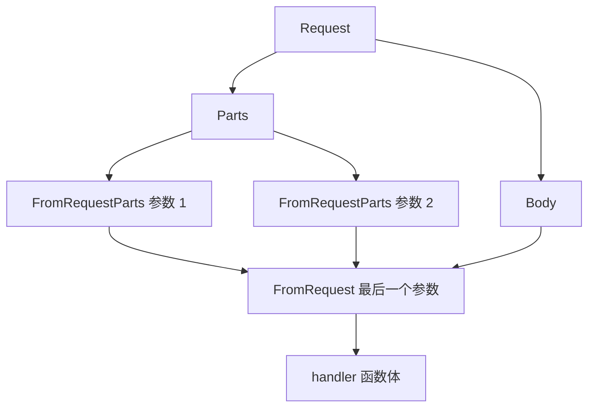
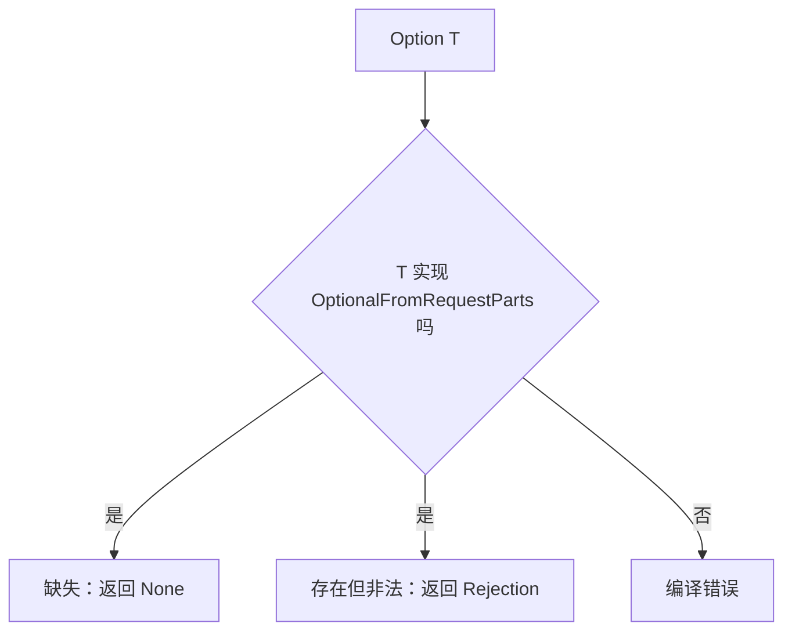

# Ch 4 提取器（Extractor）

> **本章目标**：掌握 Axum 最核心的类型系统。读完这一章，你能解释 handler 的每个参数由谁构造、为什么消费请求体的参数必须放在最后，并能写出带自定义 rejection 的提取器。
>
> 上一章我们把请求送进了正确的 handler（处理器），但 handler 只接收了路径参数。真实接口还要读取查询串、JSON 请求体、请求头、共享状态和当前用户。Axum 把「从请求中取出某个值」抽象成 trait，本章对这个 trait 进行详细解析。

## 4.1 提取器模型

### 4.1.1 handler 的参数不是你传的

先看一个已经见过的 handler：

```rust
async fn get_user(Path(id): Path<u64>) -> String {
    format!("user {id}")
}
```

`get_user` 只有一个参数，但代码里没有任何地方调用 `get_user(42)`。它的调用发生在 axum 内部：请求匹配到路由后，axum 按参数类型逐个构造值，再把这些值传进函数。2. 参数类型 `Path<u64>` 是一套解析规则（从路径参数中提取并反序列化为 u64）。在 Axum 中，所有实现了提取协议（FromRequest 或 FromRequestParts）的类型，都叫**提取器（Extractor）**。

用生活化的说法：一次请求像一份快递，面单（方法、URI、请求头）可以反复查看，包裹（body）只能拆一次；提取器就是按类型填写的取件单。

提取器只有两类，区别在于是否读取请求体：

| trait                 | 构造函数的输入       | 能否读取 body | 在 handler 中的位置 |
| --------------------- | -------------------- | ------------- | ------------------- |
| `FromRequestParts<S>` | `&mut Parts` 与 `&S` | 否            | 除最后一个参数外    |
| `FromRequest<S>`      | `Request` 与 `&S`    | 是            | 只能是最后一个参数  |

`Parts` 是 `http::request::Parts`，包含请求方法、URI、版本、请求头和 `Extensions`；`Request` 在此基础上还持有 `Body`。`Body` 不能克隆，读取一次就结束，这是参数顺序规则的根源。

把两个 trait 的形状压缩成示意代码：

```rust
// 签名示意：省略了泛型约束与具体返回类型
pub trait FromRequestParts<S>: Sized {
    type Rejection: IntoResponse;
    async fn from_request_parts(parts: &mut Parts, state: &S) -> Result<Self, Self::Rejection>;
}

pub trait FromRequest<S>: Sized {
    type Rejection: IntoResponse;
    async fn from_request(req: Request, state: &S) -> Result<Self, Self::Rejection>;
}
```

有两个设计点值得注意：

1. **失败也是一种响应**。`Rejection`（拒绝响应）必须实现 `IntoResponse`。提取失败时，axum 直接把 rejection 转成 HTTP 响应， 同时handler 不会执行。失败时默认的 400、415、422 code都来自这里。
2. **提取器可以读取应用状态**。上述的两个 trait 的第二个参数都是 `&S`，`S` 是 Router 的状态类型。`State<T>` 提取器就是从这里读取共享状态的。

### 4.1.2 请求被拆成 parts 与 body

当请求进入 handler 之前，axum 先把它拆成 `parts` 和 `body` 两部分：



这个流程是固定的：

1. 先按声明顺序运行所有 `FromRequestParts` 提取器，它们共享同一份 `Parts`，可以读取方法、URI、请求头。
2. 把 `Parts` 与 `Body` 重新组装成 `Request`。
3. 运行最后一个 `FromRequest` 提取器，它拥有 `Request` 的所有权，可以读取 body。
4. 所有提取器都成功，才调用 handler 函数体。

因此，下面这个签名无法通过编译：

```rust
// 错误示意：Json 消费了 Request 的所有权，后面的 State 无法再被提取
async fn handler(
    Json(payload): Json<Payload>,
    State(state): State<AppState>,
) {}
```

编译器会提示第一个参数的类型不满足 `FromRequestParts`。启用 `macros` feature 后，可以用第 3 章提到的 `#[axum::debug_handler]` 把这类错误整理成更易读的形式。

### 4.1.3 一个真实的混合参数

本章示例工程里有一个同时使用 parts 与 body 的 handler：

```rust
{{#include ../../examples/ch04-extractors/src/lib.rs:handler_order}}
```

`Caller` 通过组合 `AuthUser` 与 `Tenant` 读取 `Authorization` 与 `X-Tenant-Id` 两个请求头，属于 `FromRequestParts`；`Json<CreateTask>` 读取请求体，属于 `FromRequest`。顺序只能是前者在前、后者在最后。`Caller` 是本章要构建的自定义组合类型，先知道它的位置即可。

## 4.2 内置提取器

本章示例工程的结构与第 3 章一致：

```text
examples/ch04-extractors
├── Cargo.toml
├── README.md
└── src/
    ├── main.rs   # 启动壳：日志 + 监听 + axum::serve
    └── lib.rs    # 全部提取器与测试
```

路由表把演示分成两组：

- `/extract`： 放内置提取器，
- `/api/v1` 放状态、认证与组合提取器。

```rust
{{#include ../../examples/ch04-extractors/src/lib.rs:app}}
```

启动服务：

```sh
cd examples/ch04-extractors
cargo run
```

服务监听 `http://127.0.0.1:3000`。下面逐个分析内置提取器。为节省篇幅，`curl -i` 的输出省略了 `Content-Length`、`Date` 等与结论无关的响应头。

### 4.2.1 `Path`：路径参数

```rust
{{#include ../../examples/ch04-extractors/src/lib.rs:path}}
```

```sh
$ curl http://127.0.0.1:3000/extract/path/42
id = 42

$ curl -i http://127.0.0.1:3000/extract/path/abc
HTTP/1.1 400 Bad Request
...
Invalid URL: Cannot parse `abc` to a `u64`
```

`Path<T>` 的 `T` 需要实现 `serde::DeserializeOwned`（可反序列化成拥有所有权的值）以及 `Send`。常用的三种写法：

| 路径                               | 提取器类型                      |
| ---------------------------------- | ------------------------------- |
| `/users/{id}`                      | `Path<u64>`                     |
| `/users/{user_id}/tasks/{task_id}` | `Path<(u64, u64)>`              |
| `/users/{user_id}/tasks/{task_id}` | `Path<HashMap<String, String>>` |

元组按路径中捕获段出现的顺序逐位对应。axum 0.8 要求元组长度与捕获段数量严格一致：两个捕获段写 `Path<u64>`，或者一个捕获段写 `Path<(u64, u64)>`，都会在提取阶段返回 500（`WrongNumberOfParameters` 被视为路由与 handler 的配置错误），而不是悄悄忽略多余参数。值本身解析失败，例如 `abc` 转 `u64`，仍然返回 400。

`Path` 是 `FromRequestParts` 提取器，不读取 body，所以可以放在 body 提取器之前的任意位置，也可以和 `Json`、`State` 组合。

### 4.2.2 `Query`：查询串

```rust
{{#include ../../examples/ch04-extractors/src/lib.rs:query}}
```

`PageQuery` 使用用 `#[serde(default = "...")]` 给 `page` 与 `page_size` 提供默认值，`status` 是 `Option<String>`，缺失时为 `None`。`#[derive(Deserialize)]` 是 serde 的派生宏：它根据字段名生成从键值对到结构体的反序列化实现；`#[serde(default = "...")]` 指定字段缺失时调用的默认值工厂函数。

```sh
$ curl 'http://127.0.0.1:3000/extract/query?page=2&page_size=5&status=todo'
page=2, page_size=5, status=todo

$ curl http://127.0.0.1:3000/extract/query
page=1, page_size=20, status=none

$ curl -i 'http://127.0.0.1:3000/extract/query?page=abc'
HTTP/1.1 400 Bad Request
...
Failed to deserialize query string: page: invalid digit found in string
```

`Query<T>` 使用 `serde_urlencoded` 反序列化查询串，错误消息会指出具体字段。解析失败返回 400；字段缺失是否报错，取决于字段类型与 `#[serde(default)]`。

`Query` 同样是 `FromRequestParts`，不读取 body。注意 `axum::extract::Query` 不支持同名参数收集成 `Vec`（例如 `?tag=a&tag=b`）；需要这个能力时使用 `axum_extra::extract::Query`。

### 4.2.3 `Json`：JSON 请求体

```rust
{{#include ../../examples/ch04-extractors/src/lib.rs:json}}
```

```sh
$ curl -X POST http://127.0.0.1:3000/extract/json \
    -H 'content-type: application/json' \
    -d '{"title":"write ch04"}'

{"title":"write ch04","done":false}
```

成功时返回 201 Created。

```sh
$ curl -i -X POST http://127.0.0.1:3000/extract/json -d '{"title":"x"}'
HTTP/1.1 415 Unsupported Media Type
...
Expected request with `Content-Type: application/json`

$ curl -i -X POST http://127.0.0.1:3000/extract/json \
-H 'content-type: application/json' -d '{"title":'
HTTP/1.1 400 Bad Request
...
Failed to parse the request body as JSON: title: EOF while parsing a value at line 1 column 9

$ curl -i -X POST http://127.0.0.1:3000/extract/json \
-H 'content-type: application/json' -d '{"title":42}'
HTTP/1.1 422 Unprocessable Entity
...
Failed to deserialize the JSON body into the target type: title: invalid type: integer `42`, expected a string at line 1 column 11

```

`Json<T>` 的 rejection 分四类，它们的状态码不同：

| 情况                           | 状态码 |
| ------------------------------ | ------ |
| 缺少或错误的 `Content-Type`    | 415    |
| JSON 语法错误                  | 400    |
| 语法正确但字段类型或结构不匹配 | 422    |
| 请求体超过限制                 | 413    |

`Json<T>` 实现了 `FromRequest`，会消费整个请求体，因此只能出现在参数列表最后。它同时实现了 `IntoResponse`，也可以作为返回类型，它会把结构体序列化成 JSON；这里的 `Serialize` 派生负责生成序列化实现。

### 4.2.4 `State`：共享状态

共享状态

```rust
{{#include ../../examples/ch04-extractors/src/lib.rs:state}}
```

```rust
{{#include ../../examples/ch04-extractors/src/lib.rs:state_extractor}}
```

```sh
$ curl http://127.0.0.1:3000/api/v1/state
# 使用默认密钥 ch04-dev-secret 时
secret length=15
```

状态由 `.with_state(state)` 注入 Router，`State<T>` 从 `&S` 中克隆出 `T`。因此状态类型必须实现 `Clone`，并且通常是 `Arc` 包裹的共享数据。示例中的 `jwt_secret` 用 `Arc<str>` 保存，克隆 `AppState` 只增加引用计数，不会复制密钥。真实的连接池、配置、缓存会在 Ch 7 展开。

`State<T>` 是 `FromRequestParts`，可以放在 body 提取器之前。如果 Router 没有提供对应状态，或者状态类型不匹配，问题会在编译期暴露，不会拖到请求处理阶段。

### 4.2.5 `HeaderMap`：原始请求头

```rust
{{#include ../../examples/ch04-extractors/src/lib.rs:headers}}
```

```sh
$ curl http://127.0.0.1:3000/extract/headers \
    -H 'user-agent: ch04-test' -H 'x-request-id: req-1'
user-agent=ch04-test, x-request-id=req-1
```

`HeaderMap` 给出全部请求头，适合日志、透传和自定义头。注意两点：

1. 请求头的值不保证是 UTF-8，`.to_str()` 可能失败，示例用 `unwrap_or` 处理。
2. 同名头可以出现多次。`HeaderMap::get` 只返回其中一个值，需要全部值时用 `get_all`。

如果希望把请求头直接解析成强类型，例如 `UserAgent`、`Authorization` 的专用类型，可以使用 `axum-extra` 的 `TypedHeader`；Ch 10 会用到。

### 4.2.6 `OriginalUri`：嵌套路由下的原始路径

```rust
{{#include ../../examples/ch04-extractors/src/lib.rs:original_uri}}
```

```sh
$ curl http://127.0.0.1:3000/api/v1/original-uri
uri=/original-uri, original=/api/v1/original-uri
```

第 3 章讲过，`nest` 会把前缀从 `Uri` 中剥掉：handler 里的 `Uri` 是 `/original-uri`，不是对外的 `/api/v1/original-uri`。`OriginalUri` 保留进入 Router 时的完整路径，适合拼接对外链接、记录访问日志、做签名校验。

`Uri` 与 `OriginalUri` 都是 `FromRequestParts` 提取器，顺序不影响结果。

### 4.2.7 其他常用提取器

| 提取器           | trait              | 用途                                            |
| ---------------- | ------------------ | ----------------------------------------------- |
| `Method`         | `FromRequestParts` | 请求方法                                        |
| `Uri`            | `FromRequestParts` | 当前 URI（`nest` 后已剥前缀）                   |
| `Version`        | `FromRequestParts` | HTTP 版本                                       |
| `Extensions`     | `FromRequestParts` | 原始扩展表                                      |
| `Extension<T>`   | `FromRequestParts` | 取出中间件写入的类型化扩展                      |
| `MatchedPath`    | `FromRequestParts` | 命中的路由模板，适合做 metrics 标签             |
| `ConnectInfo<T>` | `FromRequestParts` | 连接信息，例如客户端地址                        |
| `Request`        | `FromRequest`      | 原始请求，最后一个参数，自行拆分 parts 与 body  |
| `Bytes`          | `FromRequest`      | 读取完整请求体为字节                            |
| `String`         | `FromRequest`      | 读取完整请求体为 UTF-8 字符串                   |
| `Form<T>`        | `FromRequest`      | 表单请求体，`application/x-www-form-urlencoded` |
| `Multipart`      | `FromRequest`      | 流式 multipart，Ch 14                           |

`Extension<T>` 与 `ConnectInfo<T>` 需要中间件或 `axum::serve` 提前写入扩展；Ch 6、Ch 20 会展开。

## 4.3 `Option<T>`、`Result<T, E>` 与 `OptionalFromRequestParts`

### 4.3.1 `Result<T, T::Rejection>`：在 handler 里处理失败

如果某个 handler 想自己决定提取失败时的响应，可以把提取器放进 `Result`：

```rust
{{#include ../../examples/ch04-extractors/src/lib.rs:result_extractor}}
```

```sh
$ curl 'http://127.0.0.1:3000/extract/query/or-default?page=abc'
invalid query, using defaults

$ curl 'http://127.0.0.1:3000/extract/query/or-default?page=3'
page=3
```

`Result<T, T::Rejection>` 的 rejection 类型是 `Infallible`，所以 handler 一定会执行。失败信息作为 `Err` 值交给 handler，由 handler 决定返回默认值、记录日志还是返回自定义错误。

这种写法适合单个 handler 的特殊需求。如果很多 handler 都需要同样的失败策略，因此应该把失败策略收敛到自定义提取器的 `IntoResponse` 实现里，或者交给 Ch 5 的 `AppError`。

### 4.3.2 0.8 的 `Option<T>` 只对部分提取器生效

`Option<T>` 看起来像「提取失败就返回 `None`」的通用包装，但 axum 0.8 不是这样设计的。`Option<T>` 只有在 `T` 实现了 `OptionalFromRequestParts`（或 `OptionalFromRequest`）时才可用：

```rust
// 签名示意：OptionalFromRequestParts 让提取器区分「缺失」与「非法」
pub trait OptionalFromRequestParts<S>: Sized {
    type Rejection: IntoResponse;
    async fn from_request_parts(
        parts: &mut Parts,
        state: &S,
    ) -> Result<Option<Self>, Self::Rejection>;
}
```

这个 trait 的关键在于：提取器自己决定什么情况算「缺失」，什么情况需要拒绝请求。



0.8 之前，`Option<T>` 对所有 `FromRequestParts` 都有实现，任何提取失败都会被转换为 `None`。这会把「请求头没带」和「token 伪造」混为一谈，对认证类提取器是严重问题。0.8 引入 `OptionalFromRequestParts`，并要求提取器显式选择加入，从而把「缺失」与「非法」分开。

内置提取器对 `<Option<T>` 的支持情况：

| 写法                     | 0.8 是否可用 | `None` 的条件       | 存在但非法时          |
| ------------------------ | ------------ | ------------------- | --------------------- |
| `Option<Path<T>>`        | 是           | 路由没有路径参数    | 400；数量不匹配为 500 |
| `Option<Json<T>>`        | 是           | 没有 `Content-Type` | 415 或 400/422        |
| `Option<Query<T>>`       | 否           | —                   | 编译错误              |
| `Option<HeaderMap>`      | 否           | —                   | 编译错误              |
| `Option<State<T>>`       | 否           | —                   | 编译错误              |
| `Option<Extension<T>>`   | 是           | 扩展不存在          | —                     |
| `Option<MatchedPath>`    | 是           | 没有命中模板        | —                     |
| `Option<TypedHeader<T>>` | 是           | 请求头不存在        | 解析失败，返回 400    |

`Option<Query<T>>` 在 0.8 中被明确移除。查询串缺失时 `Query<T>` 本来就会用空串反序列化，是否需要 `Option` 取决于业务；axum 选择不提供这个包装，避免语义含糊。确实需要时，用 `Result<Query<T>, QueryRejection>`。

### 4.3.3 `Option<Json<T>>` 的三种结果

```rust
{{#include ../../examples/ch04-extractors/src/lib.rs:json_optional}}
```

`json_optional` 使用 `Option<Json<CreateTask>>`，它的行为分三种：

```sh
# 没有 Content-Type：None
$ curl -X POST http://127.0.0.1:3000/extract/json/optional \
    -H 'Content-Type:' -d '{"title":"x"}'
no json body

# Content-Type 正确、JSON 合法：Some
$ curl -X POST http://127.0.0.1:3000/extract/json/optional \
    -H 'content-type: application/json' -d '{"title":"x"}'
title = x

# Content-Type 存在但不是 JSON：仍然拒绝
$ curl -i -X POST http://127.0.0.1:3000/extract/json/optional \
    -H 'content-type: text/plain' -d '{"title":"x"}'
HTTP/1.1 415 Unsupported Media Type
...
```

这里有一个易错的细节：`curl -d` 会自动补上 `Content-Type: application/x-www-form-urlencoded`，所以第一条命令必须用 `-H 'Content-Type:'` 显式移除这个头，才能触发「没有 Content-Type」的分支。

## 4.4 提取器组合

### 4.4.1 元组与参数上限

handler 的多个参数在内部被当作元组处理。元组提取器最多支持 **16 个元素**，handler 的参数上限也是 **16 个**。超过这个数量，需要把参数合并成一个结构体，或者使用自定义组合类型。

元组中前面的元素必须实现 `FromRequestParts`，最后一个元素必须实现 `FromRequest`（只读的 parts 提取器通过 blanket impl 自动满足）。本章示例用一个显式元组演示多个 parts 提取器；这里的 `AuthUser` 与 `Tenant` 是 4.5 要构建的提取器，我们先关注组合方式：

```rust
{{#include ../../examples/ch04-extractors/src/lib.rs:tuple_extractor}}
```

```sh
$ curl http://127.0.0.1:3000/api/v1/context \
    -H "Authorization: Bearer $TOKEN" -H 'X-Tenant-Id: 7'
{"code":0,"message":"ok","data":{"user_id":42,"tenant_id":7}}

$ curl -i http://127.0.0.1:3000/api/v1/context -H 'X-Tenant-Id: 7'
HTTP/1.1 401 Unauthorized
...
```

`(AuthUser, Tenant)` 的提取顺序就是元组中从左到右的顺序。第一个失败时，后面的提取器不会执行。

### 4.4.2 为什么要自定义组合类型

元组能解决「取多个值」，但解决不了三个问题：

1. **重复**：每个需要当前用户的 handler 都要写 `AuthUser`、`Tenant`，签名越来越长。
2. **跨字段约束**：token 里的租户与 `X-Tenant-Id` 必须一致，这个校验不应该由每个 handler 重复实现。
3. **领域语义**：handler 真正关心的是「调用者上下文」，而不是两个独立的请求头。

如果把 `AuthUser` 与 `Tenant` 合并成 `Caller`，再把校验放进 `FromRequestParts` 实现，此时 handler 只声明一个参数。`Caller` 的完整实现在 4.5 末尾。我们这里先记住原则：**能在提取器阶段拒绝的请求，不要留到 handler 里处理**。这样 handler 获得的数据已经满足前置条件，业务代码不需要重复写防御性分支。

## 4.5 自定义提取器实战

### 4.5.1 统一 rejection

自定义提取器首先需要一个 rejection 类型。它必须实现 `IntoResponse`，否则不能作为 `FromRequestParts::Rejection`。

```rust
{{#include ../../examples/ch04-extractors/src/lib.rs:rejections}}
```

示例遵循全书约定：响应信封是 `{"code", "message", "data"}`，认证错误使用 `3xxxx` 段。`Envelope<T>` 是泛型结构体，`data` 字段的类型由 `T` 决定，成功响应与错误响应共用同一套字段。这里手写了 `ExtractError`，此处简化，Ch 5 统一为 `AppError`，并补上错误链与日志。

`IntoResponse` 是 rejection 与 HTTP 之间的唯一桥梁。提取器只负责判断「这个请求是否合法」，至于失败时返回 401 还是 400、响应体长什么样，都由 rejection 的实现决定。

### 4.5.2 `AuthUser`：从 `Authorization` 头解析 JWT

目标：handler 写 `user: AuthUser`，就能获得 `user_id` 与 `tenant_id`；请求头缺失、token 过期、签名错误都由提取器统一拒绝。JWT（JSON Web Token）是一种带签名的令牌，服务端通过验签确认载荷没有被篡改。示例使用 `jsonwebtoken` crate 完成 HS256 的签发与验签，Ch 10 会在此基础上补齐登录、刷新与注销流程。

先定义类型与 JWT 载荷：

```rust
{{#include ../../examples/ch04-extractors/src/lib.rs:auth_user_struct}}
```

`Claims` 中的 `sub` 是用户 ID，`tid` 是租户 ID，`exp` 是过期时间（单位 秒）。这三个字段是示例约定，真实项目应按 Ch 10 的 token 规范扩展。

实现 `FromRequestParts<AppState>`：

```rust
{{#include ../../examples/ch04-extractors/src/lib.rs:auth_user_required}}
```

解析与验证签名的辅助函数：

```rust
{{#include ../../examples/ch04-extractors/src/lib.rs:auth_user_helpers}}
```

处理流程如下：

1. 从 `Parts` 读取 `Authorization` 头。如果Authorization缺失、不是ASCII、不是 `Bearer <token>` 形式，都将返回 401。
2. 用 `AppState` 中的密钥构造 `DecodingKey`。
3. 用 `Validation::new(Algorithm::HS256)` 固定算法并校验 `exp`。
4. 验签成功后，把 `Claims` 转成 `AuthUser`。

有两个安全要点：

- **固定算法**。`Validation::new(Algorithm::HS256)` 同时校验 token 头部的 `alg`，避免攻击者把 `alg` 改成 `none` 或换成其他算法。
- **先验签，再信任载荷**。`AuthUser` 的字段必须来自 `decode` 的返回值，不能先解析 payload 再补验签。

示例在每次提取时构造 `DecodingKey`；这样写便于演示，生产环境可以把 `DecodingKey` 放进 `AppState` 复用。

`AuthUser` 也可以做成**可选**提取器，这样公开接口既能识别已登录用户，又允许匿名访问：

```rust
{{#include ../../examples/ch04-extractors/src/lib.rs:auth_user_optional}}
```

`Option<AuthUser>` 的语义与 4.3 一致：请求头缺失时返回 `None`；请求头存在但 token 非法时返回 401，不会降级成匿名用户。

先使用一个开发用的 token：

```sh
$ curl -X POST http://127.0.0.1:3000/api/v1/dev-token \
    -H 'content-type: application/json' \
    -d '{"user_id":42,"tenant_id":7}'
# token 已截断
{"code":0,"message":"ok","data":{"token":"eyJ...","expires_in":3600}}
```

把 `data.token` 保存到环境变量（需要 `jq`；没有 `jq` 可以手动复制，然后在使用该环境遍。下面的几个命令都会在同一个 shell 会话中执行：

```sh
TOKEN=$(curl -s -X POST http://127.0.0.1:3000/api/v1/dev-token \
  -H 'content-type: application/json' \
  -d '{"user_id":42,"tenant_id":7}' | jq -r '.data.token')
```

验证三种情况：

```sh
$ curl http://127.0.0.1:3000/api/v1/me -H "Authorization: Bearer $TOKEN" {"code":0,"message":"ok","data":{"user_id":42,"tenant_id":7}}

$ curl -i http://127.0.0.1:3000/api/v1/me
HTTP/1.1 401 Unauthorized
...
{"code":30001,"message":"missing Authorization header","data":null}

$ curl -i http://127.0.0.1:3000/api/v1/me -H 'Authorization: Bearer not-a-jwt'
HTTP/1.1 401 Unauthorized
...
{"code":30001,"message":"invalid token","data":null}
```

`/api/v1/dev-token` 只是开发期辅助接口，生产环境必须删除。真实的登录、刷新、注销流程在 Ch 10。上面的示例只在本地保留默认密钥；生产环境必须通过 `JWT_SECRET` 注入，且不要提交真实密钥。

### 4.5.3 `Tenant`：多租户上下文

多租户（multi-tenant）是指同一套服务为多个租户隔离数据，每个请求都必须携带租户标识。`Tenant` 从 `X-Tenant-Id` 头解析租户 ID。示例用 `u64` 作为租户 ID；真实项目可以换成 UUID 或字符串，只要调整 `Tenant` 内部类型。推荐先实现 `OptionalFromRequestParts`，再让必需的 `FromRequestParts` 复用这套逻辑：

```rust
{{#include ../../examples/ch04-extractors/src/lib.rs:tenant}}
```

`OptionalFromRequestParts` 负责三件事：

- 请求头不存在：返回 `Ok(None)`。
- 请求头存在但不是合法数字：返回 400，错误码 `10001`。
- 请求头合法：返回 `Ok(Some(Tenant(id)))`。

必需的 `FromRequestParts` 调用可选实现，把 `None` 转成「缺少 `X-Tenant-Id`」错误。这样「缺失」与「格式错误」保持不同错误码，排查问题时能直接定位。

```sh
$ curl http://127.0.0.1:3000/api/v1/tenant/optional
tenant=none

$ curl http://127.0.0.1:3000/api/v1/tenant/optional -H 'X-Tenant-Id: 7'
tenant=7

$ curl -i http://127.0.0.1:3000/api/v1/tenant/optional -H 'X-Tenant-Id: abc'
HTTP/1.1 400 Bad Request
...
{"code":10001,"message":"X-Tenant-Id must be a number","data":null}
```

### 4.5.4 `Caller`：组合提取器

`Caller` 把 `AuthUser` 与 `Tenant` 组合起来，并强制两者指向同一个租户：

```rust
{{#include ../../examples/ch04-extractors/src/lib.rs:caller}}
```

`Caller` 的 `FromRequestParts` 实现顺序执行两个提取器，然后做一致性校验。校验失败的请求在提取阶段就返回 403，handler 不会看到不一致的上下文。

```sh
$ curl http://127.0.0.1:3000/api/v1/caller \
    -H "Authorization: Bearer $TOKEN" -H 'X-Tenant-Id: 7'
{"code":0,"message":"ok","data":{"user_id":42,"tenant_id":7}}

$ curl -i http://127.0.0.1:3000/api/v1/caller \
    -H "Authorization: Bearer $TOKEN" -H 'X-Tenant-Id: 8'
HTTP/1.1 403 Forbidden
...
{"code":30003,"message":"X-Tenant-Id does not match the token","data":null}

$ curl -i http://127.0.0.1:3000/api/v1/caller \
    -H "Authorization: Bearer $TOKEN"
HTTP/1.1 400 Bad Request
...
{"code":10002,"message":"missing X-Tenant-Id header","data":null}
```

这是一个典型的「提取器承担策略」的例子：认证、租户解析、租户一致性校验都在进入 handler 之前完成。业务 handler 只处理业务，不再写重复的 if 判断。

`Caller` 与 `Json` 组合时，顺序依然是 parts 在前、body 在后，这就是 4.1 中 `create_task` 的签名。成功时返回 201 Created：

```sh
$ curl -X POST http://127.0.0.1:3000/api/v1/tasks \
    -H "Authorization: Bearer $TOKEN" -H 'X-Tenant-Id: 7' \
    -H 'content-type: application/json' \
    -d '{"title":"write ch04"}'
{"code":0,"message":"ok","data":{"title":"write ch04","done":false,"user_id":42,"tenant_id":7}}
```

## 4.6 请求体限制与 `Bytes` / multipart

### 4.6.1 `Bytes`：读取完整请求体

```rust
{{#include ../../examples/ch04-extractors/src/lib.rs:body_limit}}
```

`Bytes` 实现 `FromRequest`，把整个请求体读进内存，适合小体积的二进制数据、Webhook 原文、签名校验。它不检查 `Content-Type`，也不做 UTF-8 校验。

```sh
$ curl -X POST http://127.0.0.1:3000/extract/bytes -d 'hello'
received 5 bytes
```

请求体越大，`Bytes` 占用的内存越多。大文件上传不能这样读，应该使用流式读取或 multipart，见 Ch 14。

### 4.6.2 `DefaultBodyLimit`：默认 2 MB

Axum 对请求体有默认限制：`DefaultBodyLimit` 默认是 **2 MB**。超过限制的请求会得到 413。可以用 `.layer(DefaultBodyLimit::max(n))` 调整，作用范围取决于挂载位置。

示例给单条路由设置了 64 字节上限：`.route("/limited", post(limited_body).layer(DefaultBodyLimit::max(64)))`。

```sh
$ python3 -c 'print("a"*64, end="")' > body64.txt
$ python3 -c 'print("a"*65, end="")' > body65.txt

$ curl -X POST http://127.0.0.1:3000/extract/limited --data-binary @body64.txt
received 64 bytes

$ curl -i -X POST http://127.0.0.1:3000/extract/limited --data-binary @body65.txt
HTTP/1.1 413 Payload Too Large
...
Failed to buffer the request body: length limit exceeded
```

如果挂到整个 Router 上，就对所有路由的 body 提取器生效：

```rust
// 片段：把限制挂到整个 Router 上
Router::new()
    .route("/upload", post(upload))
    .layer(DefaultBodyLimit::max(1024 * 1024))
```

`DefaultBodyLimit` 只约束消费请求体的提取器，例如 `Bytes`、`String`、`Json`、`Form`。`Path`、`Query`、`HeaderMap` 不读 body，不受影响。如果第三方提取器直接调用 `Body::poll_frame`，`DefaultBodyLimit` 不会自动生效；需要在传输层统一限制时，可以使用 `tower-http` 的 `RequestBodyLimit`。

### 4.6.3 multipart 预告

文件上传通常使用 `multipart/form-data`。Axum 提供 `Multipart` 提取器，需要启用 `multipart` feature：

```toml
axum = { version = "0.8", features = ["multipart"] }
```

`Multipart` 是 `FromRequest`，逐个产出字段，适合流式处理大文件。完整的字段解析、临时文件、对象存储与下载响应在 Ch 14 展开；本章只需要知道它属于「消费 body、必须放在最后」的这一类。

## 4.7 常见坑

1. **把消费 body 的提取器放在前面**。`Json<T>`、`Bytes`、`String`、`Form<T>`、`Multipart`、`Request` 都实现 `FromRequest`，只能作为最后一个参数。`(Json<T>, State<S>)` 无法编译；启用 `macros` feature 后，加上 `#[axum::debug_handler]` 可以看到更清晰的错误。

2. **以为 `Option<T>` 能包装所有提取器**。0.8 里 `Option<Query<T>>`、`Option<HeaderMap>`、`Option<State<T>>` 都是编译错误。需要可选语义时，先确认该类型是否实现 `OptionalFromRequestParts` / `OptionalFromRequest`，否则用 `Result<T, T::Rejection>`。

3. **把「非法」当成「缺失」**。认证类提取器如果对非法 token 返回 `None`，公开接口会把伪造请求当成匿名访问。`Option<AuthUser>` 只在请求头缺失时返回 `None`，token 非法仍然 401，这是 0.8 的设计意图。

4. **用 `curl -d` 测试「没有 Content-Type」**。`curl -d` 会自动补 `application/x-www-form-urlencoded`，导致 `Option<Json<T>>` 走 415 而不是 `None`。用 `-H 'Content-Type:'` 显式移除这个自动生成的头。

5. **在 `nest` 之后用 `Uri` 拼对外地址**。`Uri` 已被剥掉前缀，拼出来的链接会少 `/api/v1`。需要完整路径时用 `OriginalUri`。

6. **把路径参数数量写错**。`Path<T>` 的 `T` 与路由捕获段数量必须一致；捕获段数量不匹配会返回 500，而不是 400。值解析失败（例如 `abc` 转 `u64`）才是 400。

7. **忽略 `HeaderMap` 的非 UTF-8 值**。请求头按字节存储，`.to_str()` 可能失败。直接 `unwrap()` 会让一个畸形请求变成 panic。

8. **忘记默认请求体限制**。`Json` 默认最多 2 MB，上传大 JSON 会得到 413。需要更大限制时显式设置 `DefaultBodyLimit`，不要直接关闭限制。

9. **把 JWT 密钥写进代码**。示例的默认密钥只用于本地演示。生产环境从环境变量或密钥管理服务读取，并且固定签名算法、校验过期时间，见 Ch 10 与 Ch 18。

10. **在提取器里做耗时操作**。提取器运行在请求处理路径上，每个请求都会执行。数据库查询、远程调用等操作应该放在 handler 或服务层；提取器只做解析、校验和轻量转换。

11. **忘记 handler 参数上限**。参数与元组元素最多 16 个。超过时把相关字段合并成结构体，或者用 `Caller` 这类组合类型收敛。

## 4.8 小结

本章的核心可以压缩成三句话：

> **多个 parts 提取器共享同一份 `Parts`，body 只能消费一次；因此 `FromRequestParts` 参数在前，`FromRequest` 参数在最后。**
>
> **提取失败通过 `Rejection: IntoResponse` 直接变成响应；`Result` 把失败交给 handler，自定义 rejection 把失败策略收敛到类型里。**
>
> **`Option<T>` 在 0.8 只对实现了 `OptionalFromRequestParts` / `OptionalFromRequest` 的类型生效；`None` 的语义由提取器决定，内置实现只把「缺失」映射为 `None`。**

内置提取器覆盖了路径、查询串、JSON、状态、请求头与原始 URI；自定义提取器把认证、租户、权限等横切逻辑变成 handler 签名的一部分。`AuthUser`、`Tenant`、`Caller` 这三个类型会在后续章节继续演进：Ch 5 统一错误响应，Ch 7 注入真实状态，Ch 10 完成登录与 token 生命周期，Ch 12 接入权限模型。

下一章进入响应与错误处理：提取器的 rejection 最终要汇入全书的 `AppError`，handler 的返回值也要统一成 `{code, message, data}` 信封。

## 4.9 习题

1. **多段路径**：新增 `GET /extract/path/{owner}/{repo}`，用 `Path<(String, String)>` 提取两个参数；验证只传一段时返回 404。再注册一条只有一个捕获段、却使用 `Path<(String, String)>` 的路由，验证它返回 500，并解释两个状态码的差异。
2. **可选版本头**：实现 `ApiVersion` 提取器，从 `X-Api-Version` 头解析 `u16`；同时实现 `OptionalFromRequestParts`，要求缺失时返回 `None`、格式错误时返回 400（错误码 `10003`）。
3. **管理员提取器**：给 `Claims` 增加 `role: String`，实现 `AdminUser` 提取器：先调用 `AuthUser`，再检查 `role == "admin"`，非管理员返回 403（错误码 `30004`）。思考它应该实现 `FromRequestParts` 还是 `FromRequest`。
4. **组合类型**：把 `AdminUser` 与 `Tenant` 组合成 `AdminContext`，在提取阶段校验租户一致；handler 只接收 `AdminContext`。
5. **请求体限制**：给整个 Router 加 1 MB 的全局限制，同时保留 `/extract/limited` 的 64 字节限制。用 curl 验证两条路径的实际限制，并解释哪个 `DefaultBodyLimit` 生效。
6. **过期 token**：写一个测试，构造 `exp` 为过去时间的 token，验证 `/api/v1/me` 返回 401；再验证 `Option<AuthUser>` 同样返回 401，而不是 `None`。

## 4.10 本章对应代码路径

- `examples/ch04-extractors/src/lib.rs`：全部提取器、路由表与 17 个测试
- `examples/ch04-extractors/src/main.rs`：启动壳与 `JWT_SECRET` 读取
- `examples/ch04-extractors/Cargo.toml`：本章依赖（axum 0.8、jsonwebtoken 9、serde）
- `examples/ch04-extractors/README.md`：运行方式、路由表与 curl 示例
